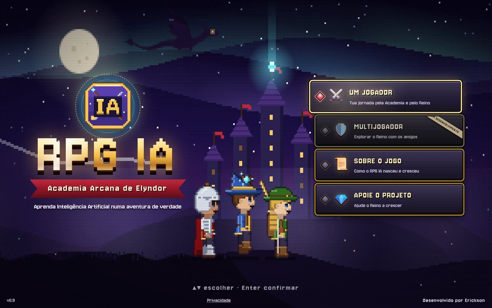
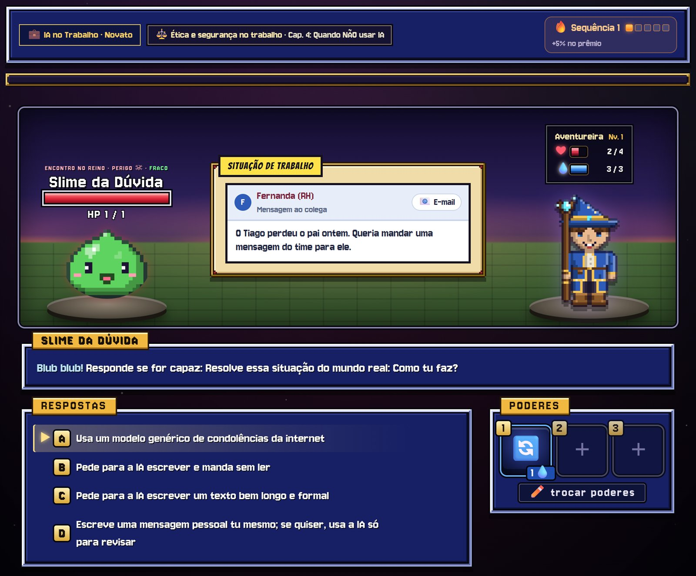

# RPG IA · Academia Arcana de Elyndor

**Aprenda Inteligência Artificial jogando.** Um RPG em pixel art, grátis no navegador, onde cada monstro é uma pergunta sobre IA: prompts, alucinação, ética, dados, automações e IA no trabalho do dia a dia.

### ⚔️ [Jogar agora: magiaia.duckdns.org](https://magiaia.duckdns.org)



## O intuito

Aprender IA não precisa ser mais um curso que a gente larga na aula 3. No RPG IA, tu entras na Academia Arcana, aprendes com o mestre Zetsu e sais pelo Reino enfrentando monstros que fazem perguntas. Cada acerto é um golpe, e cada erro abre o capítulo do livro que explica.

E não é decoreba: a maioria dos desafios são **situações reais de trabalho**, como um link que a IA inventou, a temperatura certa para extrair dados ou uma mensagem que não deveria ser escrita por uma IA.



## O que tem no jogo

- **3 classes e 15 subclasses:** mago, guerreiro e arqueiro. Cada subclasse tem a própria trilha de perguntas (automações, dados, segurança, prompts, trabalho…).
- **1.014 perguntas**, do básico ao avançado, que acompanham o nível do herói.
- **Grimório de Erros:** o que tu errou volta em 10 minutos, 6 horas e 2 dias, até ficar (repetição espaçada).
- **Provas de 10 questões** para subir de grau na classe.
- **26 livros** na biblioteca, 42 monstros, chefões em fases, dungeons e um reino com dia e noite.
- Toda a arte é **desenhada por código**, pixel a pixel.

## A história

Por mil anos, a Academia Arcana ensinou a mais difícil das magias: perguntar bem, conferir as fontes e nunca parar de aprender. Até que o mestre Malakar criou o Oráculo, uma mente única que respondia tudo, para todos. E o povo parou de pensar…

---

## Sobre esta página

Esta pasta é a página de apresentação do jogo: HTML, CSS e JavaScript puros, sem build. A cena animada do topo é o mesmo código da tela de título do jogo.

```
index.html      a página
css/estilo.css  o visual (molduras de pixel, fonte Jersey 10)
js/cena.js      a cena do título (céu, aurora, dragão, castelo e heróis)
js/site.js      galeria, classes, história, bestiário e o desafio interativo
img/            logo, sprites e prints do jogo
```

Para ver no teu computador, é só abrir o `index.html` no navegador.

### Publicar no GitHub Pages (grátis)

1. Entre no [github.com](https://github.com) e crie um repositório **público** chamado `rpg-ia` (botão **New**).
2. Na página do repositório, clique em **uploading an existing file** (ou **Add file › Upload files**) e arraste **o conteúdo** desta pasta: `index.html`, `README.md`, `.nojekyll` e as pastas `css`, `js` e `img`. Clique em **Commit changes**.
3. Vá em **Settings › Pages**. Em **Source**, escolha **Deploy from a branch**, branch **main**, pasta **/ (root)**, e clique em **Save**.
4. Em um ou dois minutos a página fica no ar em `https://SEU-USUARIO.github.io/rpg-ia/`.
5. No `index.html`, troque `SEU-USUARIO` pelo teu usuário na linha do `og:image`. É ela que faz aparecer a imagem quando alguém compartilha o link no LinkedIn ou no WhatsApp.

Se preferir o Git pelo terminal, dentro desta pasta:

```bash
git init
git add .
git commit -m "Página do RPG IA"
git branch -M main
git remote add origin https://github.com/SEU-USUARIO/rpg-ia.git
git push -u origin main
```

Depois é só fazer o passo 3.

---

Criado por **Erickson**, construído junto com IA, num ciclo de ideias, testes e muito café.
