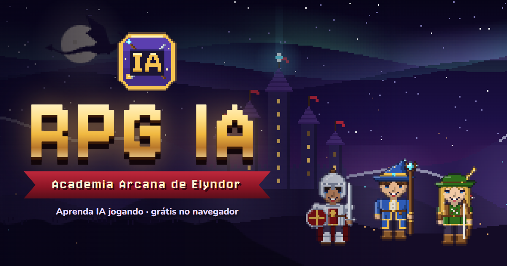
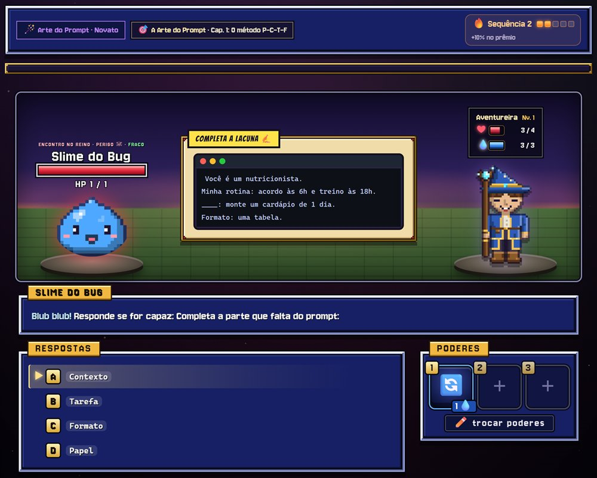
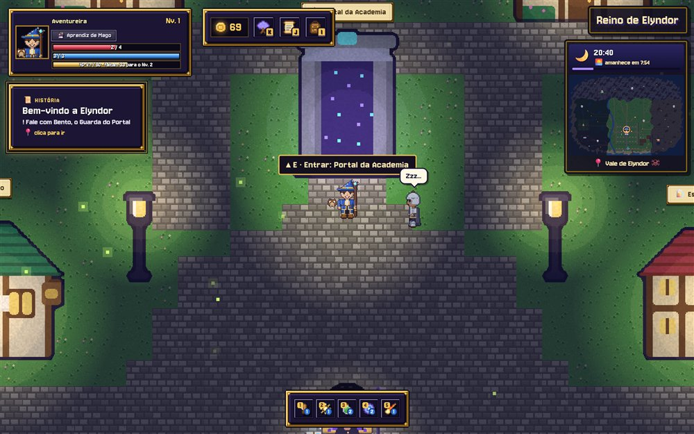

<div align="center">



# RPG IA · Academia Arcana de Elyndor

**Aprenda Inteligência Artificial jogando.** Um RPG em pixel art no navegador onde cada monstro é uma pergunta sobre IA.


</div>

| ⚔️ Batalha: cada golpe é uma resposta | 🏰 O Reino de Elyndor |
| --- | --- |
|  |  |

## Em números

- **1.014 perguntas** em 3 classes e 15 subclasses, com prova de 10 questões para subir de grau
- **42 monstros**, chefões em fases, 6 dungeons, 26 livros e dois mapas com ciclo de dia e noite
- **Grimório de Erros** com repetição espaçada: o que tu errou volta em 10 minutos, 6 horas e 2 dias
- **Multijogador em tempo real**: salão com chat, duelos, chefões em grupo, guildas e ranking semanal
- **Toda a arte é desenhada por código** em `<canvas>`, pixel a pixel. Nenhuma imagem ou áudio externo

## Arquitetura

- **Servidor autoritativo** (Flask): XP, moedas e acertos são decididos no servidor; o navegador só exibe.
- **Banco** SQLite em modo WAL, conexão reaproveitada por thread e trava entre processos.
- **Salão multijogador**: processo assíncrono à parte com `websockets`, atrás do `/salao` do Nginx.
- **Produção** (pasta [`deploy/`](deploy/)): Gunicorn com vários workers atrás do Nginx, HTTPS com Let's Encrypt, serviços e timers do systemd, backup diário do banco, fail2ban, ufw e atualização por script com backup antes de trocar o código.

> O servidor público foi desligado. Para jogar, rode localmente (abaixo) ou suba numa VM seguindo [`PUBLICAR_VM.md`](PUBLICAR_VM.md).

## Rodar localmente

```bash
python -m venv .venv
# Windows: .venv\Scripts\activate    ·    Linux/macOS: source .venv/bin/activate
pip install -r requirements.txt
python app.py          # http://localhost:5050
```

Sem `ANTHROPIC_API_KEY` no `.env`, o mestre Zetsu funciona no modo roteirizado, de graça e offline (veja [`.env.example`](.env.example)).

## Testes

Cada teste cria um herói próprio e apaga no fim. Rode da raiz do projeto:

```bash
python testes/testar_curriculo.py .     # perguntas por classe e Grimório de Erros
python testes/testar_prova.py .         # Prova do Degrau nas 18 classes
python testes/jogar_historia.py .       # joga a história inteira (31 quests, 4 provas)
python testes/testar_dungeons.py .      # as 6 dungeons
python testes/testar_duelos.py .        # salão multijogador por WebSocket
python testes/teste_carga.py . 50 6     # carga: 50 jogadores, 2 processos no mesmo banco
```

---

# Documentação do jogo 🧙‍♂️🐉

**RPG IA** é um RPG em pixel art para aprender Inteligência Artificial de verdade. A aventura se passa
na **Academia Arcana de Elyndor**, onde o arquimago Zetsu ensina a nova magia do reino: a IA.
O ícone (emblema roxo com espada, cajado e as letras "IA" em ouro) é desenhado em código em
`static/js/pixel.js` (`iconeRpgIaCanvas`) e vira o logo do topo e o ícone da aba.

Jogo web para quem está começando em Inteligência Artificial. Em Elyndor, conhecimento é poder:
o reino era sustentado pela Essência do Conhecimento até que Malakar, o Arquimago Esquecido, tentou
dominá-la inteira e causou a **Grande Ruptura**. Do conhecimento partido nasceram criaturas e uma
magia nova, a **IA**. Na Academia Arcana, o mago **Zetsu** ensina aprendizes a dominá-la: conceitos,
a arte do prompt, missões práticas e, no fim, um projeto completo para domar o dragão.

O universo segue o documento de design do jogo (GDD de Elyndor): o prólogo abre a história e cada
chefão derrotado revela um fragmento do que aconteceu na Ruptura.

## A entrada do aventureiro

0. **Saves**: cada navegador tem até **3 personagens** (3 saves). Ao abrir o jogo aparece a tela de
   saves, com retrato, classe, nível e moedas de cada um; dá para criar um novo nas vagas livres ou
   apagar um (com confirmação). Na Encruzilhada e no lobby da Academia tem o botão 💾 Trocar de save.
   O personagem é criado **uma vez só**: para mudar a classe, só apagando o save e começando de novo.
1. **Abertura** (`static/js/introducao.js`): o Zetsu aparece em pixel art nítido na frente da
   Academia, se apresenta com falas de máquina de escrever (clica ou Enter para seguir) e pergunta o
   **nome**. Depois oferece a **introdução**: 7 cartões animados (o reino, as classes, a Academia, as
   batalhas, a evolução, o Mercado e os controles), com setas, bolinhas, teclado e **Pular**. Ela
   também abre pelo botão 📘 Como jogar, na Encruzilhada.
2. **Criador de personagem** (`static/js/avatar.js`), em abas. A vitrine anda no lugar e só vira
   quando tu clicas nela:
   - **Vocação** (a classe principal): mago (casaco bordado, cajado, varinha, grimório ou orbe),
     guerreiro (armadura, sobreveste e capa; espada, espada e escudo, machado ou martelo) ou arqueiro
     (túnica, colete de couro e aljava; arco longo, arco élfico ou besta). Cada vocação mostra só as
     próprias armas.
   - **Corpo**: masculino ou feminino, e 7 tons de pele (ou qualquer cor).
   - **Rosto**: 8 expressões, cor dos olhos e um detalhe (óculos, sardas, cicatriz, tapa-olho,
     bigode, cavanhaque, barba, brinco ou cachecol).
   - **Cabelo**: 11 cortes (curto, espetado, franja lateral, longo, rabo de cavalo, tranças,
     maria-chiquinha, coque, cacheado, moicano, raspado) e a cor.
   - **Roupa**: o que vai na cabeça (10 opções), cor da roupa, cor dos detalhes e aura.
   - **Mascote**: coruja, gato, dragãozinho e os conquistados.
3. **Classe**: a vocação vira a classe principal no servidor. O Zetsu apresenta o iniciante da classe
   (Aprendiz de Mago, Recruta ou Batedor) e as 5 subclasses que ele vai poder escolher no nível 4.
   Toda classe aprende o mesmo conteúdo; o que muda são os poderes e o jeito de contar a história.
4. **Teste de aptidão** em forma de conversa, que monta a trilha personalizada.

**O jogo se adapta à classe**: cada herói tem uma **trilha preferida**, a da subclasse ou, enquanto é
iniciante, a `trilha_inicial` da classe (mago: Fundamentos de IA; guerreiro: Ética e Segurança;
arqueiro: Arte do Prompt). Quase metade das perguntas do Reino sai dela (`sortear_pergunta(...,
preferida=)`), as missões dela saem 4 vezes mais (`missoes.py`), os livros que combinam aparecem
primeiro na estante com ⭐ e a Mestra Lúmen indica um deles. A dificuldade continua vindo do perigo do
monstro e o nível libera as regiões. Na batalha, o acerto tem a cara da classe ("Feitiço em cheio!",
"Golpe em cheio!", "Flecha na mosca!").

**Moradores vivos**: alunos, moradores do Reino e fregueses da estalagem passeiam devagar perto de
casa (`passeia` nos lugares, em `mundo.js`) e param, virados para o herói, quando ele chega perto.

**Espelho do Mercado**: dentro do Mercado de Elyndor, no canto esquerdo, um espelho abre o criador em
modo limitado: muda cabelo, rosto, roupa, cores, aura, arma da própria vocação e mascote, mas a
vocação e o corpo ficam travados.

## Diálogos em quadrinho

As fases acontecem num "palco": o Zetsu de um lado, o personagem do aluno do outro, e as respostas
do aluno saem como falas dele. Cada fala do Zetsu pode trazer uma `cena`, um painel de quadrinho
desenhado por `static/js/cenas.js`:

```json
{ "texto": "Um LLM prevê a próxima palavra...",
  "cena": { "tipo": "fluxo", "titulo": "Como um LLM pensa",
            "itens": [{ "icone": "📚", "texto": "Lê **muito texto**" }, { "icone": "💬", "texto": "Prevê a **próxima palavra**" }] } }
```

Tipos de cena: `destaque`, `fluxo`, `comparacao`, `grade` e `codigo` (veja o topo de `cenas.js`).

## Como rodar

```bash
pip install -r requirements.txt
python app.py
```

Abra http://localhost:5050.

## Modo roteirizado x IA de verdade

O jogo funciona **sem nenhuma IA**: falas, quiz e a avaliação de prompts são
roteirizados em Python (`avaliador.py`). É de graça e roda offline.

Para ligar a IA, copie `.env.example` para `.env` e coloque uma `ANTHROPIC_API_KEY`.
Aí o Zetsu passa a dar uma **segunda opinião** sobre o prompt e o pitch do aluno, com versão melhorada.

## Publicar online

Há dois caminhos, com o mesmo pacote:

- **VM própria** (Vultr em São Paulo, Ubuntu): guia em [PUBLICAR_VM.md](PUBLICAR_VM.md). Os scripts ficam
  em `deploy/`:
  - `instalar.sh` monta a máquina do zero com um comando: nginx, gunicorn como serviço, HTTPS com Let's
    Encrypt, firewall, fail2ban, atualizações automáticas e backup diário por timer do systemd;
  - `atualizar.sh` troca o código sem tocar nos saves;
  - o nginx já deixa passar WebSocket para o futuro modo online.
- **PythonAnywhere** (gerenciado): passo a passo em [PUBLICAR.md](PUBLICAR.md).

Para os dois:

- `python empacotar.py` monta `publicar/rpg-ia.zip` só com o que o servidor precisa;
- `wsgi.py` é a entrada do site publicado (debug sempre desligado);
- `backup_banco.py` é o backup diário.

Para rodar no próprio computador, `python app.py`. Com `FLASK_DEBUG=1`, ele recarrega sozinho e mostra o
depurador. Esse modo nunca vai para a internet, porque deixaria qualquer um rodar código no servidor.

## Progresso no servidor

Cada aluno é um **jogador** com um id próprio, guardado no banco SQLite `dados/academia.db` (criado
sozinho na primeira vez que o servidor sobe; outro caminho com `BANCO_ARQUIVO`). O navegador guarda só esse
id e uma cópia do progresso para abrir mais rápido.

**Pronto para vários jogadores** (`banco.py`):

- **WAL com `synchronous=NORMAL`:** leituras não esperam gravações; quem chega enquanto outro grava espera
  até 15 s.
- **Conexão reaproveitada por linha de execução:** abrir e fechar a cada operação custava ~5 ms. Simular a
  história inteira caiu de 71 s para 2 s.
- **Trava por jogador** (`trava_do_jogador`, em `before_request` de `jogador.py`): trava de arquivo do
  sistema, que vale entre os processos do servidor publicado. São 64 faixas, então jogadores diferentes
  quase nunca esperam um pelo outro, e o mesmo jogador é atendido um pedido de cada vez.
- **Limites:** heróis novos por IP por hora (`LIMITE_CRIAR_POR_HORA`, padrão 150, folgado porque numa escola
  a turma toda sai pelo mesmo IP), opinião da IA por hora (`LIMITE_IA_POR_HORA`) e pedidos de até 512 KB. Tudo na tabela `limites`; o próprio computador não tem limite.
- **Faxina:** histórico com os 300 registros mais novos por jogador, batalhas encerradas apagadas depois de
  3 dias e contadores com mais de 1 dia apagados.
- **Medido com dois processos no mesmo banco:**
  - 60 compras simultâneas do mesmo jogador terminaram com moedas e itens exatos;
  - 50 jogadores agindo sem parar fizeram ~150 pedidos/s, mediana de ~40 ms e nenhum erro de servidor.

- **O que vale de verdade é decidido no servidor** (`jogador.py`): XP, moedas, vida, itens, troféus,
  lições concluídas, leituras, enigmas, dungeons e batalhas. O navegador pede a ação ("respondi",
  "quero comprar") e o servidor confere as regras, aplica e devolve o estado novo. Mexer no
  localStorage ou no console não dá moedas.
- **O que é só visual ou de navegação** (avatar, classe, sala, posição no mapa) o navegador salva
  sozinho, pelo `PUT /api/jogador/<id>/progresso`. O servidor ignora qualquer campo que seja dele.
- **Batalhas do Reino**: o servidor guarda a vida do monstro, sorteia a pergunta da rodada (sem
  repetir as últimas 40), corrige e entrega o prêmio só quando o monstro cai.
- **Histórico**: toda recompensa, compra, desmaio e batalha fica registrada
  (`GET /api/jogador/<id>/historico`).
- **Quem já jogava antes** é migrado sozinho: na primeira vez, o progresso do navegador vira um
  jogador no servidor.
- **Curva de XP e eras** (`progressao.py`): cada nível pede `50 + 30 × nível` de XP, e os níveis se
  agrupam em eras (Aprendiz 1–10, Explorador 11–20, Mestre 21–35, Arquimago 36+).
- **Ainda falta endurecer**: as estrelas de cada lição são contadas no navegador (cada resposta já é
  corrigida no servidor, mas a soma não); o servidor limita de 1 a 3 e nunca paga a mesma lição duas
  vezes. Os visuais vestidos também não são conferidos contra os que o aluno comprou.

Para começar do zero, é só apagar o arquivo `dados/academia.db` com o servidor parado.

## Domínio, regiões e missões

- **Domínio por trilha** (`dominio.py`, `conteudo/trilhas.json`): cada pergunta, lição e dungeon tem
  uma `trilha` (Arte do Prompt, Fundamentos de IA, Código e Automação, Ética e Segurança, IA no
  Trabalho). Acertos no Reino (pontos = perigo do monstro), estrelas novas nas lições, a primeira
  vitória numa dungeon e livros lidos dão domínio. As patentes vão de Novato a Mestre; subir paga
  moedas e, a partir de **Adepto**, cada acerto daquela trilha é um **golpe certeiro** (tira 2 de vida
  do monstro). Na batalha, um selo mostra a trilha da pergunta; na mochila, a aba 🎓 Domínio.
- **Regiões por nível** (`conteudo/regioes.json`): uma barreira mágica roxa fecha cada região até o
  herói ter o nível dela (Floresta 3, Pântano 4, Deserto 6, Montanhas 9). O servidor também recusa
  batalhas contra monstros de região trancada (`regiao` em `conteudo/monstros.json`). No minimapa,
  as regiões trancadas ficam escuras, com 🔒 e o nível.
- **Missões sorteadas** (`missoes.py`, `conteudo/missoes.json`): o herói sempre tem 3 missões
  ("vence 3 lobos", "acerta 4 perguntas de Ética e Segurança", "lê um livro"...), sorteadas só entre
  as que dá para cumprir agora (nível, regiões liberadas, chefões restantes, livros não lidos).
  Botão 📜 no topo ou tecla **J**: resgatar paga a recompensa e sorteia outra; trocar custa 10 moedas.

## Som e música

Tudo é gerado no navegador com Web Audio (`static/js/som.js`), sem baixar arquivo nenhum:

- **Trilha épica de RPG** com uma orquestra sintetizada: metais na melodia (com vibrato e eco), cordas
  sustentando os acordes, harpa em arpejo, baixo, cordas curtas e ritmadas nas batalhas, tambores
  taiko e prato, tudo passando por um reverb de salão. São 6 temas: abertura (majestoso, ré menor),
  Academia (mágico, fá maior), Reino (heroico, ré maior), Mercado e Estalagem (alegre, sol maior),
  batalha (tensa, mi menor) e chefão (sombrio, ré menor, taikos pesados). Cada tema é escrito em
  `MUSICAS` como acordes por compasso, melodia em colcheias e um compasso de bateria. Cada tela chama
  `Som.musica("nome")`, e a música muda sozinha quando o lugar muda.
- **Efeitos**: clique nos botões, porta ao entrar em lugares, moeda (ganhar ou gastar), golpe de cada
  classe (feitiço, espada, flecha), impacto, crítico, dano, bloqueio, magia, cura, magia de classe,
  explosão, rugido de chefão, morte do monstro, vitória, derrota, subida de nível e evolução de classe.
- **Vida no mundo**: aldeões e alunos "falam" com bipes curtos quando cumprimentam ou soltam um
  comentário; slimes fazem *bloop*, lobos rosnam e uivam, sapos coaxam, escorpiões chiam, esqueletos
  batem os ossos e dragões batem as asas. O volume cai com a distância até o herói.
- **Ambiente** (`Som.ambiente`, presets em `AMBIENTES`): cada lugar tem um vento contínuo (ruído
  filtrado que "respira") e sons soltos sorteados. Quem escolhe o ambiente é `cenario.ambiente`, chamado
  a cada 600 ms.

  | Lugar | Sons |
  |---|---|
  | Campos | Pássaros |
  | Floresta | Folhas |
  | Pântano | Sapos e bolhas |
  | Deserto | Areia |
  | Montanhas | Vento uivante |
  | Noite | Grilos e corujas |
  | Chuva | Pingos e trovão |
  | Cinzas | Lava estalando |
  | Cristais | Sininhos |
  | Abismo e Trono | Zumbido grave |
  | Salas | Lareira |

- **Passos** (`Som.passo`): o som muda conforme o chão (grama, pedra, neve, areia, madeira, lama). Na
  areia, na neve e na lama o pé levanta poeira.
- **Voz das falas** (`Som.blip`): o texto aparecendo faz um "blip" com a altura de voz de cada
  personagem. O narrador das cenas tem voz grave.
- **Volume**: no menu (**Esc**) → "Som e volume", com música, efeitos, ambiente, a **velocidade do
  texto** e "silenciar tudo". Fica guardado neste navegador. O áudio só começa depois do primeiro clique
  ou tecla (regra dos navegadores).

## Imersão: diálogos, clima, chefões e cerimônias

- **Diálogo de RPG** (`dialogoRPG` em `quests.js`): falar com um morador abre uma caixa embaixo da tela,
  com o retrato numa moldura, o nome em ouro e o texto em páginas curtas. Clique, Enter ou Espaço
  passam a página. Nas quests, a conversa vem primeiro e a carta aparece depois, só com objetivos,
  recompensa e botão.
- **Clima e vida** (`desenharClima` em `reino.js`):
  - chuva de vez em quando nos campos e na floresta: uma pancada de uns 5 minutos a cada ~45
    (`estaChovendo` em `reino.js`; o mesmo céu para todos, pelo relógio, com som de chuva e trovão);
  - neve nas montanhas, névoa no pântano e rajadas de areia no deserto;
  - vagalumes à noite e bandos de pássaros de dia.
- **Mecânica de cada chefão** (`MECANICAS_CHEFE`): um efeito nas cartas de resposta, anunciado na
  primeira rodada. Só atrapalha a vista: a resposta certa continua a mesma.

  | Chefão | Mecânica |
  |---|---|
  | Rei Slime | Gosma |
  | Fenrir | Uivo que sacode e, na fúria, só a carta sob o cursor fica clara |
  | Sapo Rei | Névoa: passar o mouse para enxergar |
  | Escorpião | Veneno nas letras |
  | Ignis | Brasas |
  | Colosso | Terremoto |
  | Rainha de Cristal | Reflexos que trocam as cartas de lugar |
  | Leviatã | Maré |
  | Ymir | Cartas congeladas por 2,4 s |
  | Nyxar | Sombra das asas |
  | Vazio | Cartas que somem e voltam e, na última fase, também trocam de lugar |

- **Cerimônia do título** (`cerimoniaDoTitulo`): subir um degrau do caminho da classe abre uma tela com
  o círculo mágico carregando, o herói erguido no pilar de luz, o selo do título novo e a novidade. No
  último degrau, tudo fica dourado e aparece o aviso da Fenda.
- **Perguntas de situação**: o banco do Reino tem 393 perguntas, 84 delas em forma de e-mail ou chat de
  trabalho.

## Menu de pausa

A tecla **Esc** abre o menu do jogo: continuar, controles (lista de teclas),
som e volume, tela cheia (**F**), voltar à Academia, rever a história de Elyndor, como jogar, trocar de
save e sair do jogo (volta à tela de saves). Esc não abre o menu por cima da mochila, da introdução,
do prólogo ou de outra janela; nesses casos ele fecha a janela aberta.

**O mundo congela com janela aberta** (`emEspera` em `mundo.js`): com menu, mochila, Livro do Herói,
pergaminho ou cena por cima do mapa, ninguém anda e nenhum monstro puxa luta. Ao fechar, os monstros ainda
esperam 0,9 s (`FOLGA_AO_VOLTAR`) antes de poder encostar. E toda luta começa fechando o que estiver aberto
(`fecharJanelasAbertas` em `app.js`): antes, um monstro podia atacar com o menu aberto e o menu continuava
na frente da batalha.

O portão da Academia leva direto ao Reino (a antiga Encruzilhada saiu), e no Reino o Portal da Academia
faz o caminho de volta.

## Dia e noite

O Reino tem um dia de 24 minutos: cada minuto de verdade é uma hora do Reino (`momentoDoDia()` em
`static/js/reino.js`). O relógio é de cada save: conta a partir de `progresso.inicioDoDia`, marcado
quando o save é criado. Por isso toda aventura nova começa às 6h da manhã, mesmo que outro save esteja
de noite. Os saves antigos, sem esse marco, seguem o relógio de antes. O dia claro vai das 5h30 às 17h30, o entardecer alaranjado até as 20h, a noite
até as 4h e o amanhecer até as 5h30. À noite a tela e o minimapa escurecem, o herói carrega uma
lanterna, portas e postes acendem e aparecem vaga-lumes.

À noite, os moradores vão para casa. A exceção são os da **história principal**: quem dá quest
principal ou é procurado por ela (`daHistoria` em `cenarioReino`). Esses ficam na rua a noite toda, para
a história nunca travar esperando amanhecer.

Em cima do minimapa fica o **relógio do Reino**: a hora, quanto falta para anoitecer (ou amanhecer) e
uma barrinha enchendo ao longo do período.

**O Reino em 32 pixels**: o mapa é desenhado no dobro da resolução (`resolucao: 2` no cenário,
`RESOLUCAO_REINO` em `static/js/cenario_hd.js`). A lógica continua em unidades de 16 por tile, mas cada
tile vira 32 × 32 pixels de verdade, e herói, moradores e monstros aparecem no tamanho nativo (o herói
ocupa uns 7% da altura da tela, como num RPG de 32 px).

As **salas** (lobby e salas da Academia, biblioteca, sala da carreira, Mercado e Estalagem) também são
desenhadas no dobro da resolução (`salaEmHD` em `cenario_hd.js`): chão, paredes, móveis e portas passam
pelo filtro de pixel art, mas as pessoas continuam no tamanho de antes, então entrar num prédio dá um
"close" (os personagens ficam maiores que no Reino). Os desenhos marcados como gente
(`marcarPersonagem` em `heroi.js`) nunca passam pelo filtro.

- **Chão**: um tileset de 32 × 32 com 4 variações de cada tipo (grama com tufos e flores, mata com
  folhas caídas, caminho com pedrinhas, praça de paralelepípedos, água com marolas e vitórias-régias,
  rocha com rachaduras, neve, lama com poças, plantação, pontes) e as camadas de transição (espuma na
  beira da água, borda das rochas, mato invadindo o caminho). O chão é montado em blocos de 16 × 16
  tiles, cada um desenhado uma vez só e guardado, então a tela inteira custa uns 9 desenhos por quadro.
- **Árvores**: redesenhadas em alta resolução, com cachos de folhas, luz em cima, sombra embaixo,
  tronco com casca e sombra no chão (e maçãs nas redondas). Os pinheiros têm andares de galhos e neve
  nas montanhas. O vento usa poses prontas (a copa deslocada de -4 a +4 pixels), um desenho por árvore.
- **Casas, lugares e o resto**: o desenho original ampliado com o filtro Scale2x (dobra a resolução
  arredondando as diagonais, sem borrar) e uma textura leve por cima. Ficam 2x maiores que as pessoas,
  com colisão e estradas seguindo o tamanho (`tilesDaBase`); árvores e casas ficam meio transparentes
  quando o herói passa por trás.
- **Imagens salvas**: o jogo usa o que está em `static/img/cenario/`: `chao-tiles.png` (tileset),
  `cenario-desenhos.png` (uma folha com todos os desenhos do Reino e das 8 salas) e `manifesto.json`
  (onde está cada coisa).
  São 2 imagens no total, carregadas junto com os dados do jogo. O código continua sendo a fonte: depois
  de mudar um desenho, rode `exportarCenarioHD()` no console do navegador (com o servidor em modo
  debug) e as imagens são regeradas (rota `/dev/cenario/<arquivo>`, que só aceita pedidos do próprio
  computador). Se as imagens faltarem, o jogo desenha tudo pelo código.

**A estátua da praça** é o Erickson em pixel, como **Arquimago de Elyndor**: cabelo cacheado, barba,
sorriso, brinco e braços cruzados, de manto preto com ouro, capa forrada de roxo e ombreiras com gema.
O cajado de cristal e o grimório flutuam ao lado, runas giram em volta e, à noite, o cristal ilumina a
praça de roxo. Chegando perto, **E** lê a placa (`spriteEstatuaArquimago`, `animarEstatua` e
`TEXTO_ESTATUA` em `reino.js`).

- **Formas noturnas**: ao escurecer, os slimes viram **Slime Fantasma da Madrugada** (translúcido), os
  lobos viram **Lobo Sombrio da Lua**, os sapos viram **Sapos Luminosos** (acendem o pântano), os lobos
  das neves viram **Lobos Espectrais** e os escorpiões dão lugar aos **esqueletos**. Ao amanhecer voltam
  ao normal. Quem tem forma noturna diz isso em `noite` dentro de `TIPOS_MONSTRO`.
- **Criaturas que só saem à noite** (`POPULACAO_NOITE`): **Morcegos do Cache** nos campos e na floresta
  (voam rápido e perseguem), **Assombrações do Código Morto** na floresta (atravessam as árvores) e
  **Fogos-Fátuos Alucinados** no pântano (iluminam a escuridão em volta). De dia elas somem.
- **Bônus da noite**: monstro com `"daNoite": true` em `conteudo/monstros.json` paga +25% de moedas e XP
  (`bonus_noite`). A missão **Caçador da Lua** pede 3 deles, e as missões de slimes e lobos contam as
  formas noturnas também.
- **Aldeões vão para casa**: no entardecer cada morador se despede e anda até a porta mais próxima
  (caminho calculado pelo mapa), some lá dentro e volta para o seu canto de manhã.

## Animações e transições

- **Herói**: 6 quadros por direção, com passada, braço balançando, respiração parada, piscar de olhos e
  um "achatar" rápido ao virar. O desenho tem proporção de adulto (32 × 51): pernas mais compridas
  (`PERNA_EXTRA`), ombros largos, sobrancelha, nariz, mandíbula, olhos sem o brilho de desenho infantil e
  bochecha corada só na cara tímida. O mago usa sobretudo com abas até o joelho. Os moradores usam o
  mesmo desenhador, então ficam no mesmo estilo. Quem desenha o herói no chão alinha pelos pés (`PE_HEROI`).
- **Itens raros com efeito** (`EFEITOS_ITEM` e `EFEITOS_CHAPEU` em `heroi.js`): os épicos brilham na mão
  e soltam algumas partículas; os lendários soltam mais e ganham um anel de poder pulsando no chão.
  Cada um tem seu tipo: faíscas douradas, brasas (Escudo de Dragão, Chapéu de Fogo), neve (armas de
  gelo), fumaça (Grimório Proibido, armas sombrias), raios (Martelo do Trovão, Orbe da Tempestade) e
  runas girando (Lâmina Rúnica, Besta Rúnica). Aparece no mapa e na vitrine do criador e do espelho.
- **NPCs vivos**: respiram parados, alguns passeiam pela sala ou pela vila, viram para o herói,
  cumprimentam quando ele chega perto e soltam balões de fala de tempos em tempos.
- **Transições**: entrar ou sair de um lugar fecha a tela em pixels na diagonal com o nome do lugar;
  um monstro que te ataca fecha a tela num círculo vermelho antes da batalha.
- **Subida de nível**: um pilar de luz com raios, o herói no centro, o número do novo nível e a lista
  do que foi liberado (técnicas, regiões, escolha de subclasse).

## Batalha animada

`static/js/batalha_fx.js` desenha uma camada de partículas por cima da batalha (no Reino e nas dungeons):

- **Ataque da classe**: o mago lança um orbe de magia na cor da magia dele; o guerreiro avança até o
  monstro e corta (três cortes no crítico); o arqueiro dispara uma flecha (três no crítico).
- **Dano**: o número pula de cima do monstro (`−1`, `CRÍTICO −2`); quando o herói erra, garras
  vermelhas, tela piscando e `−1 ❤`. Escudo, esquiva e magia de classe aparecem como uma bolha azul.
- **Técnicas e magias de classe**: cura com partículas verdes, escudo em bolha, visão em anéis; a
  magia de classe mostra o ícone gigante e explode na cor da raridade.
- **Fim da luta**: o monstro se desfaz nos pixels do próprio desenho; o chefão ruge e pisca ao mudar de fase.

## HUD de RPG, mana e as 5 habilidades

- **HUD do mapa** (canto de cima): retrato do herói, nome, nível e as barras de **vida**, **mana** e **XP**.
  Do lado ficam as moedas e os botões (árvore, missões, mochila), como espaços de inventário com a tecla
  no canto (K, J, I).
- **Cara de jogo, não de site** (bloco "CARA DE JOGO, NÃO DE SITE" no fim do `style.css`):
  - **Molduras em pixel art de verdade:** desenhadas no canvas em `icones.js` (`MOLDURAS_PIXEL`) e esticadas
    como 9-slice com `border-image`. Os cantos ficam intactos e as bordas se repetem, como nas janelas dos RPGs
    de 16 bits. Viram as variáveis `--px-*`:
    - `painel` (janela escura com aro de ouro): HUD, menus, modais e painéis;
    - `pergaminho`: missões, provas, a trilha pelo Reino e as placas dos lugares;
    - `dialogo` (a caixa de fala azul clássica): falas do Zetsu e o menu de escolha;
    - `botao`, `botao-luz` e `botao-escuro`: os botões;
    - `slot` (espaço de inventário).
  - **Sem cara de site:** nada de cantos arredondados, degradês suaves nem sombras borradas.
  - **Telas cobertas:**
    - batalha: janelas na caixa de diálogo azul, poderes em espaços de inventário, barra de turno e selos com quina;
    - mercado, mochila, saves, criador, certificado, livros, quadros das cenas e conversas com NPC.
  - **Barras de rolagem em pixel:** alça dourada em degraus; dentro dos pergaminhos, o trilho é de couro.
  - **Fonte:** a **Jersey 10** em pixel no jogo todo (`--fonte` e `--fonte-titulo`), com
    `font-size-adjust: cap-height 0.64` e sem negrito falso (`font-synthesis: none`). Ela ganhou num teste
    de legibilidade lado a lado: a Pixelify Sans em negrito trocava "Z" por "B" e "Ç" por "Q", a VT323 parece
    terminal e a Press Start 2P é larga demais para frases. A Nunito fica só de reserva (`--fonte-leitura`).
- **Menu de escolha do Zetsu** (`escolherCartaRitual`): no teste de aptidão, a escolha é uma janela de
  diálogo com uma linha por resposta e o cursor ▶ piscando. Setas, mouse, Enter ou teclas 1 a 4; a escolhida
  pisca e a janela fecha.
- **A trilha pelo Reino** (na revelação) é um diário de jornada em pergaminho: marcos em espaços de inventário,
  numerados, e os selos "Recomendada" e "Opcional".
- **Ícones em pixel** (`static/js/icones.js`): moeda, árvore, pergaminho, mochila, as 5 habilidades e os
  do placar das dungeons, desenhados em texto-pixel com contorno automático. `iconeRpg(nome)` devolve a
  imagem e `imgIconeRpg(nome)` o ``; o HTML usa ``.
- **Mana**: uma só, no mapa e na batalha (`mana` no progresso, regras em `conteudo/magias.json`). O
  máximo cresce com o nível, ela **recarrega sozinha** (1 ponto a cada 12 s; o pedaço que está
  recarregando aparece mais claro na barra) e cada acerto na batalha devolve um pouco. A batalha começa
  com a mana que o herói tem e devolve o que sobrar.
- **Barra de habilidades** (embaixo, teclas **1 a 5**, `habilidades_mapa`):
  1. 💨 **Corrida** (1 de mana): corre bem mais rápido por 8 s, levantando poeira.
  2. 🔆 **Luz Arcana** (1): um halo de luz em volta do herói por 1 minuto; à noite a lanterna dobra de tamanho.
  3. 💚 **Cura** (2): recupera 1 coração.
  4. 🌀 **Teleporte** (2): volta para o Portal da Academia (só no Reino).
  5. ☄️ **Golpe Arcano** (1, só se acertar): dispara na direção em que o herói olha; o monstro atingido
     começa a luta com 1 de vida a menos.
  Cada espaço mostra a tecla, o custo, o tempo que falta (enquanto vale) e fica cinza sem mana.
  Quem confere e cobra a mana é o servidor (`/api/jogador/<id>/habilidades-mapa/<id>`).
- **Na batalha**, a barra mostra só os **3 poderes equipados** (teclas **1, 2 e 3**) e um ✏️ que abre a
  Árvore na aba Poderes para trocar no meio da luta. Os poderes vêm do grimório (gastam mana) ou das
  magias da classe (uma vez por batalha e depois recarregam em horas de verdade). A escolha fica em
  `progresso.poderesEquipados` (chaves `g:<técnica>` e `c:<magia>`); quem nunca escolheu leva os 3 primeiros.
- No alto da batalha fica a **ficha do herói**: retrato, barras de vida e mana com o número em cima e um
  rastro claro que mostra o tamanho do golpe; a vida pisca quando está no fim.
- **Visual de JRPG** (tudo preso em `.encontro` no fim do `style.css`): janelas azuis com moldura de metal
  e etiqueta dourada, arena com céu, horizonte e chão em perspectiva (vermelha nos chefões), plataformas
  de pedra embaixo do monstro e do herói, HP do monstro em número, menu de **Respostas** com letras A–D e
  cursor ▶ (setas ↑↓ ou mouse movem, Enter escolhe) e o painel de **Poderes** com encaixes de metal na cor
  da raridade.
- **Tudo numa tela só**: na luta o cabeçalho do site (corações, nível, XP) some; o nome e o perigo do
  monstro viram a placa em cima da barra de HP dele e a vida/mana do herói ficam em cima do herói. O
  cartão da pergunta (e-mail, chat, código, verdadeiro ou falso) aparece compacto **no meio da arena**,
  entre os dois lutadores. O topo só guarda a trilha e a sequência.

## Tela inicial

`titulo.js`: a primeira tela do jogo. A cena (`criarCenaTitulo`) é composta à mão em pixel art:
- **Céu:** aurora ondulando, estrelas cadentes e a lua.
- **Fundo:** montanhas com neve e a Academia num morro. A torre central lança um feixe de luz, e há bandeiras, janelas que piscam e névoa.
- **Movimento:** o dragão (`desenharDragaoVoando`) cruza o céu da esquerda para a direita, batendo as asas e ondulando a cauda; três heróis (o do jogador no meio) ficam num penhasco olhando o castelo, brasas sobem e há parallax no mouse.

Por cima, o logo em ouro metálico com uma faixa vermelha e o menu em placas de pedra com moldura dourada
(↑↓ e Enter, ou o mouse); o rodapé diz "Desenvolvido por Erickson":
- **Um Jogador**: vai para os saves (na primeira visita, já cria o personagem).
- **Multijogador**: com o selo "Novo", escolhe o aventureiro (`telaSaves({ multi: true })`) e entra no Salão
  de Elyndor (veja "O Salão de Elyndor (multijogador)" abaixo). Quem ainda não tem herói cria um antes.
- **Sobre o jogo**: como o RPG IA nasceu e os marcos do desenvolvimento (`MARCOS_DESENVOLVIMENTO`).
- **Apoie o projeto**: a chave Pix aleatória (`CHAVE_PIX`) com botão de copiar.

## O Salão de Elyndor (multijogador)

Um castelo enorme (84 × 56 tiles, `lobby.js`) onde os aventureiros se encontram em tempo real. Não há
monstros. Cada jogador aparece com o mesmo corpo do herói (giro 3D, gestos do G e mascote), o nome e o selo
do título.

- **O Coliseu:** a arena virou um coliseu redondo (areia com brasão, parapeito com friso dourado, quatro anéis
  de degraus de pedra com almofadas e corredores de escada, muralha com ameias e braseiros, o túnel dos
  duelistas a oeste, portões ao sul e a leste com estandartes e o camarote imperial no norte, com o placar
  ao vivo flutuando em cima). O chão dele é pintado ponto a ponto por cima do chão em alta resolução
  (`pintarColiseuHD`), para os anéis saírem redondos.
- **Sentar na arquibancada:** quem para num degrau vira para a arena e senta (`cenario.assento` no
  `mundo.js`); com duelo rolando, a plateia balança e levanta vibrando. Cada navegador decide pela posição,
  sem mensagem a mais na rede.
- **Os dragões do castelo:** dois dragões enormes (o vermelho e o do vazio) passam quase o tempo todo
  pousados (40 a 80 s em cada lugar): nas torres do coliseu, no alto da fachada e no chão (a praça, o
  jardim, o ninho do Mirante e a areia do coliseu, que eles deixam quando começa um duelo). Parados,
  respiram, piscam, olham em volta, balançam a cauda, esticam as asas, cochilam ("z z z") e rugem soltando
  fogo. O pouso tem fases: chegam desacelerando, empinam, batem as asas abertas, descem as patas, levantam
  poeira ao tocar o chão e dobram as asas; a decolagem agacha, abre as asas e sobe levantando poeira. O
  desenho (`desenharDragaoParado`, o mesmo corpo no chão e no ar) é feito numa tela pequena em alta
  resolução, com contorno escuro e sombreado, e ampliado sem suavizar. São enfeite e cada navegador tem os seus.

- **O mapa:** ao norte, a Sala de Estudos, o Grande Salão com o **Palanque** (quem fala de cima dele é ouvido
  no salão inteiro, com balão dourado) e a Sala de Troféus com os **Campeões da Arena** (o ranking de vitórias
  em duelos nos últimos 30 dias); no meio, a Praça com a fonte, os bancos, as árvores e os lampiões; a oeste,
  a Galeria com o **Quadro de Anotações** enorme; a leste, a **Arena** com arquibancada e o Mestre da Arena
  Draven; ao sul, o jardim e o portão de saída.
- **Chat de balão** (T para falar): a frase aparece em cima do herói para quem está perto (260 unidades) e
  num histórico curto no canto. Clicar num jogador (ou no nome dele no chat) abre o **cartão**: retrato,
  título, nível, placar de duelos e os botões Desafiar, Acenar, Silenciar (só para quem silencia) e Denunciar.
- **Quadro de Anotações:** recados de até 280 letras, em 5 cores, que todos veem (e aparecem como papeizinhos
  no quadro do mapa). Até 3 por jogador, 1 por minuto, somem em 7 dias; o autor tira o seu; 3 denúncias de
  pessoas diferentes escondem o recado.
- **Duelos na arena** (o servidor sorteia, cronometra e corrige; os dois vão para os lados da arena e todo
  mundo vê o placar flutuando em cima dela):
  - **X1 de perguntas** (5, 10 ou 20): a mesma pergunta para os dois ao mesmo tempo; acertar vale 100 e a
    rapidez dá até 50 a mais. No último terço, as perguntas ficam um nível mais difíceis.
  - **Até um cair:** 3 corações cada e uma torre de monstros-pergunta (3 perguntas por monstro, do Slime da
    Dúvida até o Ignis), cada vez mais difícil; cada erro tira um coração.
  - **Perguntas dos jogadores** (3 ou 5 cada): cada um escreve as suas (com a alternativa certa, passando pelo
    filtro) em até 6 minutos, e o outro responde. No fim dá para denunciar as perguntas do oponente.
  - Convite com 30 s para aceitar, revanche no fim, desistir (ou cair a conexão) dá a vitória ao outro. O
    placar vai para `estatisticas.duelos` do herói (vitórias, derrotas e empates, também por modo). Duelos
    não dão XP nem moedas, de propósito: dois amigos não podem "fazer farm" um com o outro.
- **Moderação** (`moderacao.py`): recusa palavrões e ofensas (também disfarçados: "p.u.t.a", "id10ta"),
  links, e-mails, telefones e pedidos de contato fora do jogo, CAPS LOCK e texto repetido. 3 denúncias de um
  jogador em 24 h deixam ele 30 min sem falar. `moderar.py` lista recados e denúncias e apaga recados.

- **O pódio da Sala de Troféus:** os três primeiros do ranking da arena (30 dias) aparecem de pé nos
  pedestais com o visual de cada um, o nome, o título e as vitórias (o 1º no meio, mais alto, com luz
  dourada); lugar sem campeão ainda mostra a taça. Muda na hora quando um duelo termina.
- **Ninguém sai do Salão sem escolher:** só o portão, o menu de pausa (Academia, trocar de aventureiro, sair)
  e o "ir até" das quests (que pergunta antes) levam para fora. O que só "volta ao mapa" (o fim da Prova do
  Degrau, o Mercado, vestir uma peça) devolve ao Salão, no mesmo lugar (`telaMapa` confere `estaNoSalao`).
  Entrar no Multijogador sem herói pronto mostra um aviso, com a opção de ir criar no Um Jogador.
- **Movimento dos outros:** interpolação com atraso (150 ms) entre as posições que chegam, com
  extrapolação curta se a rede atrasar; o servidor manda as posições 20 vezes por segundo (só de quem se
  mexeu) e o Salão desenha no máximo um quadro sim e um não em monitores rápidos (`quadrosPorSegundo`).

- **O Distrito das Casas** (o mapa cresceu para 84 × 96 tiles, ao sul do jardim, pela passagem no muro): a
  Praça das Bandeiras com o monumento da **Taça das Casas** (o placar da semana flutuando em cima), os três
  salões (cada um com o chão na cor da casa, o estandarte com o brasão em pixel 13 × 13, braseiros
  e o Arauto) e o **Círculo da Fenda**, com os obeliscos e o Altar. As Casas: 🌙 **Ordem da Lua Partida**
  (roxa, a lua rachada com estrelas), 🔥 **Legião da Fênix Rubra** (vermelha, a fênix de asas abertas) e
  🐺 **Clã do Lobo de Jade** (verde, a cabeça do lobo de olhos dourados). Os ids internos continuam `runa`,
  `aco` e `flecha` (saves e placar antigos).
- **As Casas (como guildas):** 3 fixas. Quem entra no Salão pela primeira vez escolhe uma (ganha o manto
  dela); dá para trocar a cada 7 dias. O ícone da Casa vai junto do nome, o chat tem o canal da Casa (Tab
  troca; chega a todos da casa em qualquer lugar do castelo) e tudo soma pontos para a Taça da semana
  (`casas_pontos` no banco): duelo vencido 10, jogado 3, Fenda fechada 15, Pergunta do Dragão 5, Desafio do Dia 3.
- **A Pergunta do Dragão:** a cada 12 minutos (`SALAO_DRAGAO_MIN`), com alguém online, um dragão pousa na praça e
  solta uma pergunta para todo o castelo (cartão no alto, sem pausar). Quem acertar primeiro ganha XP,
  moedas e o Manto do Dragão Dourado; quem acerta depois fica sabendo.
- **As Fendas do Oráculo (chefões em grupo):** no Altar, alguém abre a Fenda e o castelo inteiro é chamado; de 2
  a 4 heróis entram. O chefão (um dos 11 chefões do jogo, pelo nível do grupo) aparece enorme no céu do
  círculo; cada herói responde a sua pergunta, acerto tira vida (rápido é crítico), erro quebra um escudo
  do grupo; abaixo da metade ele entra em fúria (menos tempo). Fechar a Fenda dá XP, moedas, o Manto da Fenda.
- **A Liga da Semana:** quem vencer mais duelos de segunda a domingo vira o Campeão da semana seguinte: aura
  dourada e 👑 no nome, de pé no camarote do coliseu e o Manto do Campeão.
- **O Desafio do Dia** (o Oráculo do Dia, o cristal da Praça das Bandeiras; rotas `/api/jogador/<id>/desafio-dia`):
  5 perguntas, as mesmas para todos no dia (a data é a semente), uma tentativa; acertar 3 conta para a
  sequência 🔥, e a cada 7 dias seguidos abre o baú (moedas, elixires e o Manto da Chama Constante).
- **Prêmios do Salão:** visuais exclusivos (os mantos novos do `itens.json`) e um pouco de XP e moedas, com
  teto por dia (`LIMITE_DIARIO`: 400 de XP e 200 moedas) para o multijogador não virar o jeito de subir de nível.
- **Mais vida:** a plateia vê a pergunta do duelo num cartão e dá o palpite (e a torcida faz barulho), música
  própria do Salão, o **modo foto** (P: some o HUD, entra a moldura dourada) e botões de toque no celular
  (falar, gestos, interagir e foto).

**Como funciona por dentro:** `salao.py` é um processo à parte, assíncrono (pacote `websockets`), com todo o
estado do lobby na memória; o que precisa durar (recados, denúncias, duelos) vai para o mesmo SQLite (tabelas
`recados`, `denuncias` e `duelos`). O navegador conecta em `/api/salao` → `ws://...:5051` (no computador, o
`python app.py` sobe o Salão junto) ou `wss://<site>/salao` (publicado, pelo nginx). O id do save só vai para
o servidor; os outros jogadores são conhecidos por um número da conexão (`sid`). As posições vão e voltam 10
vezes por segundo e cada navegador suaviza o movimento dos outros. Limites: 300 conexões, 80 por IP, 20
mensagens por segundo por conexão. Teste: `testes/testar_duelos.py`.

## Escolha do aventureiro, menu de pausa e HUD

- **Escolha do aventureiro** (`telaSaves`): a cena da tela inicial ao fundo (sem os heróis do penhasco),
  o logo dourado com a faixa "Escolhe teu aventureiro", um botão de volta ao menu inicial e cartas com
  moldura de ouro: cada herói num pedestal brilhante, animado com os efeitos dos itens dele; a vaga vazia
  é um portal girando. Apagar um herói abre a confirmação do jogo (`confirmarRPG`, a mesma da escolha
  da subclasse): janela de pedra com caveira, o retrato do herói sumindo e "Manter o herói" / "Apagar
  para sempre" (Esc cancela).
- **Menu de pausa (Esc)**: as mesmas placas de pedra e ouro da tela inicial, em duas colunas, com ↑↓ e o
  título "Pausa" em ouro. "Trocar de aventureiro" vai para os saves; "Sair do jogo" volta para a tela
  inicial (`voltarAoTitulo`). Os dois passam pela despedida (`despedirSe`): "Jogo salvo", o herói
  acenando e "Até logo", e a tela se fecha num círculo de pixels antes da próxima ser montada por
  baixo. Na tela inicial e nos saves o Esc não abre a pausa.
- **"Modo jogo"** (`atualizarModoMundo`): em toda tela de jogo o topo mostra o HUD novo (retrato, vida,
  mana e XP com "faltam N para o próximo nível"); a faixa antiga de corações e nível saiu. Na tela inicial,
  nos saves e na criação do personagem não há HUD (Zetsu pedindo o nome, criador, classe e teste de
  aptidão). A barra de habilidades do mapa some ao sair do mapa.
- **Criador de personagem**: a vitrine desenha só o quadro que está aparecendo (`quadroDaVitrine`), em vez
  dos 12 quadros da caminhada a cada troca. As prévias das vocações são desenhadas depois do clique e só
  na aba Vocação. Cada troca de roupa responde na hora.
- **Minimapa**: o retrato do herói ficou menor e parado.
- **O ritual e a revelação**: o Zetsu do ritual usa o desenho atual dele em pixel nítido, flutuando
  entre runas que giram; a revelação mostra a carta da classe com raios de luz e a trilha como um mapa
  de jornada (marcos numerados num caminho dourado).

## História e quests

`conteudo/historia.json` (servidor: `quests.py`; jogo: `static/js/quests.js`).
- **A história** ("Neste reino, conhecimento é poder"): em Elyndor, cada verdade compreendida vira magia.
  O maior dos mestres, Malakar, criou o Oráculo, uma mente única que respondia tudo, e o povo parou de
  pensar. Dessa fome de resposta pronta nasceu o **Vazio**. Na Grande Ruptura o Oráculo se partiu, e os
  pedaços do saber esquecido viraram os monstros que perguntam.
- **Mistério**: as cartas de "L." e os fragmentos dos chefões (I a XI) revelam aos poucos que:
  - Malakar está preso no Abismo;
  - Lyra, a Sentinela, é filha dele e abriu a Fenda para salvá-lo;
  - o Vazio usa o rosto de Malakar.
- **História principal**: 9 capítulos e 31 quests, uma de cada vez, cada uma dada por um morador, com
  nível mínimo. Capítulo novo abre com uma cena animada e um cartão na tela.

  | Capítulos | Onde | Destaques |
  |---|---|---|
  | I a V | Reino | Termina em Ignis, com a revelação do nome na escama e a quest do Ulf |
  | VI · O Último Título | Reino, níveis 10 a 15 | Os três Selos do Saber (Morgana, Samira e Capitã Ivy) guiam o caminho até o último degrau |
  | VII a IX | Umbraterra | Lyra e o Eco de Malakar, os quatro guardiões, Nyxar e o Vazio |

  Os capítulos VII a IX têm `"mundo": "umbra"` e só saem no último degrau da subclasse.
- **Escolhas** (`"escolha"` na quest, guardada em `progresso.escolhas`): a escolha aparece na carta da
  quest antes de entregar.
  - **Confiança** (`h-noite-ecos`): confiar na carta de L. ou mostrá-la ao Ulf.
  - **Perdão** (`h-eco`): perdoar a Lyra ou exigir a verdade inteira.

  As escolhas trocam falas das quests (`"variantes"`), as falas da Lyra e do Eco (`falasAgora`, que também
  mudam conforme a história anda) e acrescentam uma cena da Lyra no epílogo (`epilogoDaEscolha`).
- **Chefão final**: **o Vazio, a Mente Única** (`vazio` em `monstros.json`), com 15 de vida e 3 fases. Ele
  aparece no Trono só depois que Nyxar cai (`depois` em `CHEFES_UMBRA`).
- **O fim** (`telaFinal` em `prologo.js`): a quest `"final": true` abre a escolha entre **Libertar
  Malakar** e **Selar o Abismo**. Cada escolha tem o seu epílogo de 4 cenas (`EPILOGOS`). Depois vêm os
  créditos com os números da jornada. A escolha fica em `progresso.finalDoJogo`.
- **Quests dos moradores**: 16 (como *Caçada noturna*: vencer 4 lobos à noite), liberadas pelo nível.
- Objetivos: `monstro` (filtros `tipo`, `regiao`, `forca`, `noite`), `chefe` (`tipo`), `acerto` (`trilha`),
  `enigma`, `leitura`, `licao`, `dungeon` e dois só das quests: `falar` (`npc`) e `visitar` (`cidade`).
- Recompensas: moedas, XP, itens e visuais **exclusivos** (`cosmetico` ou `cosmetico_por_classe`).
- No mapa, quem tem quest mostra **!** (dourado na história, azul nos moradores) e **?** para entregar,
  também no minimapa. Falar com o morador abre a carta da quest (aceitar ou entregar). O rastreador no
  canto mostra o objetivo atual; o diário (J) lista a história, as quests e o quadro de missões.
  Entrar numa cidade mostra a faixa com o nome dela.
- **Clicar para ir**: no diário, a história principal fica em destaque dourado, e cada quest, missão
  do quadro e morador com quest é clicável: o herói anda sozinho até o objetivo (`destinoDoObjetivo` em
  `quests.js`: o morador, a placa da cidade, o covil do chefão, o monstro certo mais perto, o enigma
  mais perto, a Academia). O rastreador do canto também é clicável. O caminho usa uma busca com arrays
  numéricos (`caminharAte` em `mundo.js`, ~25 ms para atravessar o Reino) e `mundoAtivo.caminharPara`.
- Rotas: `POST /api/jogador/<id>/quests/<quest>/aceitar`, `.../entregar` e `.../quests/evento`
  (`falar` e `visitar`). O progresso fica em `quests` (`ativas` e `concluidas`), campo do servidor.

## Livros em pixel

- **A estante** (`abrirEstante`): os livros ficam em pé numa prateleira de madeira, como lombadas na cor
  de cada um, com o ícone e o título na vertical e alturas diferentes.
  - Os lidos ganham um ✔ dourado; os que combinam com o caminho do herói, uma ⭐.
  - Passar o mouse puxa o livro um pouco para fora e mostra o resumo embaixo.
- **O livro aberto** (`abrirLivro`): capa de couro na cor do livro, com moldura dourada, e duas páginas
  de pergaminho com a costura no meio e uma fita marcadora.
  - Na página esquerda: a capa em pixel art (`capaDoLivro`) e o sumário, com ✔ nos capítulos já lidos.
  - Na página direita: o capítulo, com letra capitular e ornamento no título.
  - Trocar de capítulo vira a página para a frente ou para trás.
  - O marcador guarda onde o herói parou (`progresso.leitura`) e a estante mostra "🔖 cap. N". Os
    capítulos lidos ficam em `progresso.capitulosLidos`.
  - Os guias da Sala da Carreira usam o mesmo livro.
- **Teste teu saber** (`testeDoCapitulo`): no fim de cada capítulo, até 3 perguntas de batalha que saem
  dele. Elas vêm de `GET /api/praticar/<fonte>/<id>/<capítulo>` sem o gabarito e são corrigidas em
  `POST /api/praticar/corrigir`. É só treino, sem prêmio.

## Currículo da classe: cada classe aprende o seu ofício

Cada degrau do caminho da classe tem uma **skill** com lição de verdade e perguntas só dela
(`conteudo/curriculo.json` e `conteudo/perguntas_classes.json`, 1014 perguntas, de 16 a 18 por skill, 261 com
situação de trabalho e 214 com código). Cada pergunta tem `dificuldade` de 1 a 3 (1: reconhecer o conceito;
2: aplicar numa situação; 3: caso sutil, combinar ideias ou achar o erro), com pelo menos 5 de cada por skill:

- **Degrau 1, classe principal:** Mago, "Como a IA pensa"; Guerreiro, "Escudo básico: dados e senhas";
  Arqueiro, "Mira básica: o prompt claro".
- **Degraus 2 a 5, subclasse** (4 skills cada, cada vez mais avançadas, no foco da subclasse). Exemplos:
  - Alquimista: planilhas → análise → juntar fontes → painéis;
  - Artífice: scripts → agendar e integrar → automação com IA no fluxo → agentes;
  - Sentinela: phishing → logs → prompt injection → red teaming;
  - Patrulheiro: dados de treino → modelos clássicos → métricas → viés.

  As três subclasses da mesma trilha estudam coisas diferentes: Runas, Comandante e Caçador são todos de
  prompts, mas um faz técnicas e contexto, outro delega e avalia, o outro formato e extração.

**Como o jogo puxa o currículo** (`conteudo.sortear_pergunta`):

- As perguntas da classe só caem para o herói daquela classe e só até o degrau dele.
- A fatia da batalha que sai do currículo cresce com o degrau (`CHANCE_DA_CLASSE`: 30% no degrau 1 até 60%
  no 5). Dentro dela, 60% é a skill do degrau atual e o resto revisão das anteriores.
- Depois de dominada, a skill do degrau atual vira revisão: cai para 30% da fatia, e a fatia inteira encolhe
  um quarto (`CHANCE_SKILL_ATUAL_DOMINADA` e `FATOR_CLASSE_DOMINADA`), para o herói não ficar respondendo as
  mesmas perguntas até o próximo degrau.
- Na fase de chefão de uma trilha, as perguntas do currículo daquela trilha também valem.
- **Jeito de aprender da classe principal** (`estilos` no `curriculo.json`): o Mago (Sabedoria) puxa mais
  situações reais; o Guerreiro (Prática), mais lacunas de código e passos em ordem; o Arqueiro (Precisão),
  mais verdadeiro ou falso relâmpago.

**Dominar uma skill:** 5 acertos (`curriculo.py`, `ACERTOS_PARA_DOMINAR`). Na batalha, a pergunta do
currículo mostra o selo verde "Lição da tua classe" e, ao dominar, aparece o aviso "Skill dominada".

**Prova do Degrau** (`curriculo.py`, rotas `/api/jogador/<id>/prova/iniciar` e `/prova/responder`, tela
em `static/js/prova.js`): subir de degrau não é só nível.

- **Quando abre:** quando a skill do degrau atual está dominada (aviso "Prova liberada!"; o cartão fica na
  aba Ofício). A do degrau 1 é a **Prova do Aprendiz**, que a subclasse exige; no último degrau não há prova.
- **Como é:** 10 perguntas só do currículo da classe do herói, do fácil ao difícil (`ROTEIRO_DA_PROVA`):
  3 de aquecimento (dificuldade 1, revendo as skills de baixo), 4 de aplicação (2) e 3 de desafio final (3)
  da skill nova. No Salão das Provas, com o Mestre Zetsu de examinador, cada resposta acende uma runa na
  trilha (verde ou vermelha), a explicação aparece na hora e o salão muda de cor conforme a dificuldade.
- **Resultado:** aprova com 7 (`NOTA_APROVACAO`), carimbo "APROVADO", prêmio (120 XP × degrau, mais 80 se
  gabaritar, e 60 moedas × degrau) e a promoção, se o nível do degrau já estiver cumprido. Reprovou: carimbo
  "AINDA NÃO", 10 minutos de espera (`ESPERA_REPROVADO`) e os erros vão para o Grimório de Erros.
- **Regra do degrau** (`habilidades.degrau` e `degrauDaClasse` no app.js): do degrau 2 em diante, cada subida
  pede a prova do degrau de onde o herói está (`progresso.provas`). Saves de antes da prova ganham as provas
  dos degraus que já tinham.

**Grimório de Erros** (repetição espaçada, `curriculo.py`): toda pergunta errada numa batalha volta
depois como **eco** (selo vermelho "Eco de um erro · revanche!"), em 10 minutos, depois 6 horas e depois
2 dias. Acertar as três voltas tira a pergunta do grimório; errar recomeça do início.

**No Livro do Herói (K), aba Ofício:**

- o foco da classe e o jeito de aprender;
- cada skill do caminho com a lição, 3 dicas, a barra de acertos e o botão "Estudar na biblioteca";
- o Grimório de Erros: quantos esperam revanche, quantos já podem voltar e quantos ecos foram vencidos.

O servidor manda tudo em `estado.curriculo`, e o progresso guarda `skills`, `grimorioErros` e `ecosVencidos`.

## Biblioteca e de onde vem cada pergunta

- **Biblioteca**: 26 livros (144 capítulos) em 6 estantes, uma por trilha: Programação, Automação,
  Inteligência Artificial, Arte do Prompt, Segurança e Ética, IA no Trabalho. A **Sala da Carreira**
  tem 6 guias com 57 capítulos.
- **Perguntas**: o banco do Reino (`perguntas_reino.json`) tem 333 perguntas, e quase todas têm
  `"fonte": {"livro" ou "guia", "capitulo"}`.
  - `conteudo.fonte_da_ref` completa a fonte com o título e o capítulo. Para perguntas de lição ou de
    dungeon, a fonte diz o nome da lição ou da dungeon.
  - Na batalha, um selo mostra "📖 Livro · Cap. N: título". Clicar nele abre o capítulo por cima da
    luta.
  - A explicação de cada resposta termina dizendo onde estudar aquilo.

## Itens, raridades e economia

- O catálogo (`conteudo/itens.json`) tem 8 consumíveis e 94 visuais. Cada visual tem **raridade** e
  **bônus** que cresce com ela: XP e ouro nas vitórias, mana e vida máximas, segundos a mais para
  responder e sorte de drop (`equipamento.py`; só vale o que o herói tem e está vestindo; com teto).
  Preços por raridade: comum 400, raro 1.200, épico 3.000, lendário 6.500.
- Itens novos vêm com `visual` (o desenho-base, as cores trocadas e o efeito de partículas):
  `registrarVisuaisDoCatalogo` coloca eles no criador e no desenho do herói, sem mexer em `heroi.js`.
- **Exclusivos**: de quest (`exclusivo` + `origem`) ou de **drop** raro de uma região (`drop`).
- **Drops**: cada vitória tem ~7% de chance de um consumível (mais com sorte); chefões sempre deixam
  um Grande Elixir e têm muito mais chance do visual raro da região.
- **Ouro dos monstros pela metade** (`FATOR_OURO_MONSTRO`) e **curva de XP mais dura**: a partir do
  nível 4 cada nível pede também 5 × (nível − 3)² de XP (`progressao.py` e o espelho no `app.js`).
- Novos consumíveis: Tônico Arcano (+3 mana) e Elixir Arcano (mana cheia), pela Mochila.
- **Desenho real dos itens** (`desenhoDoItem` em `app.js`): arma e chapéu são pintados pelas mesmas
  funções do herói numa tela vazia e recortados; roupa e aura mostram o herói vestindo; mascote, o mascote.
  Na loja cada peça é animada (`desenharItemNaVitrine`): brilho da raridade, raios girando nos lendários
  e as partículas do efeito (raios, brasas, neve, fumaça, runas); o detalhe mostra o herói vestindo a
  peça com o efeito. A Mochila e as cartas de quest usam o mesmo desenho.
- **A loja** é uma loja de RPG: o balcão com a Brina e a prévia do herói vestindo a peça, e a vitrine
  com abas (Consumíveis, Da tua classe, Para todos, Exclusivos) e filtro de raridade.

## O ritual da aptidão

O teste de aptidão acontece numa câmara com velas. As respostas são cartas de tarô
(`escolherCartaRitual`), e orbes de cristal mostram o andamento:

- as cartas chegam distribuídas em leque, girando do verso, e flutuam;
- cada uma traz o numeral, o ícone num círculo que pulsa na cor dela, o título e a fala do herói;
- com o mouse, a carta inclina em 3D e um reflexo de luz corre por cima;
- escolhida, ela sobe e acende enquanto as outras caem;
- clique, teclas 1 a 4 ou setas.

O círculo mágico do chão (`circuloMagicoRitual`) é desenhado num canvas, visto em perspectiva:
- três anéis girando em sentidos opostos, as runas e um hexagrama;
- um nó para cada pergunta;
- faíscas subindo.

A cada resposta, o nó da pergunta acende, uma onda de energia corre o chão e sobe um pilar de luz na cor
da carta. No fim, o círculo acelera, fica dourado e clareia antes da revelação. A revelação usa o mesmo
círculo, girando devagar. Ele substituiu o círculo antigo em CSS 3D, que pesava a tela.

## Cenas da história

`static/js/cenas_historia.js` (`CENAS_HISTORIA`) traz cenas animadas em pixel art, tocadas pelo motor do
prólogo:
- **Capítulos**: 2 cenas para cada um dos 9. A do capítulo I toca na primeira entrada no Reino; as
  outras, ao entregar a última quest do capítulo anterior, antes do cartão do capítulo.
- **Revelações**: "A Verdade de Lyra" (quest `h-eco`) e "A Memória de Malakar" (`h-leviata`).
- **Entrada dos chefões** (`cenasDoChefe` e `entradaDoChefe`): na primeira vez contra cada um dos 11
  chefões, a luta só começa depois de duas cenas.
  - Na primeira, o chão treme e a silhueta dele surge.
  - Na segunda, um clarão revela o chefão animado no brilho da cor da região, dizendo a primeira fala dele.

  O botão "⚔️ Lutar!" começa a batalha.
- **Músicas** (`som.js`): "mistério" toca nas cenas, "umbra" em Umbraterra, "vazio" na luta final e
  "triunfo" no epílogo e nos créditos. Depois de cada cena, volta a música do mapa.

Cada cena toca uma vez por herói (`progresso.cenasVistas`). O título aparece e some sozinho, e o diário
(J, aba Missões) tem "🎬 Rever" com o prólogo e as cenas já vistas.

## Tela de carregamento

`carregamento.js`: uma ilustração **parada** em pixel art (`desenharCenaCarregamento`, desenhada uma vez).
O herói, com o visual do jogador, está de costas no alto de um penhasco, olhando o destino sob a lua ou o sol.
O céu é em faixas com pontilhado, com estrelas, montanhas e o castelo ou as casas ao longe.

Em volta da cena:

- no alto, a placa com o nome do lugar, em moldura de pixel;
- embaixo, a **Dica do Zetsu** numa caixa de diálogo azul, com o rosto dele;
- a barra "Carregando" em 20 blocos.

Só a barra enche e o cursor ▼ da dica pisca. Cada destino tem as suas cores: `inicio` (abertura do jogo),
`reino` (dia no campo), `academia` (noite com o castelo) e `porta` (entardecer, nas lojas e salas).
A paisagem animada (`criarPaisagem`) continua só na tela inicial.

**Desempenho:** medido num notebook de 8 núcleos, em tela de 1366×768.

| | antes | depois |
|---|---|---|
| Abrir o Reino pela 1ª vez | 15,8 s | 1,3 s |
| Abrir a Academia pela 1ª vez | 3,7 s | 0,4 s |

O mapa continua a 60 quadros por segundo. O gargalo era o contorno dos sprites (`contornar`), que lia os
pixels de volta da placa de vídeo uma vez por quadro de cada morador. Agora:

- **Sprites pequenos na memória do processador:** `criarTela` cria os canvases de até 256×256 com
  `willReadFrequently`, então ler os pixels de volta ficou barato.
- **Contorno direto nos bytes:** `contornar` trabalha numa passada só, com uma escrita no final.
- **Cache dos estáticos:** todo `url_for('static', ...)` leva `?v=<data do arquivo>` (`app.py`), para o
  navegador não ficar com JS/CSS velho depois de uma atualização.

A tela de carregamento entra já visível, e a tela nova só começa a montar depois que ela foi pintada
(`transicaoPixel` espera dois quadros). Montar o Reino pela primeira vez trava o navegador por alguns
segundos; antes, nesse tempo, ficava só a cortina verde da transição na frente.

- `abrirCarregamento({ tema, titulo, sobretitulo, icone, avatar })` devolve `{ concluir }`.
- `transicaoPixel(..., { carregar: {...} })` mostra a cena enquanto a tela está coberta: espera o
  `aoCobrir` terminar e um tempo mínimo (`minimo`, em ms), enche a barra e abre os pixels.
- Aparece na abertura do jogo, ao abrir um save, ao ir para o Reino ou a Academia, ao entrar e sair de
  lojas e salas e no botão "Voltar ao Reino" das lojas. As batalhas continuam só com a cortina (rápido).

## Fonte pixel

Os textos pixel usam a **Jersey 10** (Google Fonts). A Pixelify Sans saiu porque o 5 dela parecia um S.
A Jersey 10 é menor no mesmo tamanho, então cada regra que a usa tem `font-size-adjust: cap-height 0.64`
(deixa as maiúsculas da mesma altura de antes) e `font-synthesis: none` (sem negrito falso).

## Caminhada

O herói anda em **8 quadros** (`QUADROS_ANDAR` e `PASSOS` em `heroi.js`, 16 quadros por segundo): as pernas
seguem um seno, a perna que vem para a frente sobe ao cruzar a outra, o tronco desce 1 pixel quando o pé
pisa (os pés não saem do chão), o braço balança ao contrário e, de lado, a barra da roupa ou a ponta da
capa fica para trás (`barraAoVentoLado`). Os quadros 8 e 9 são a respiração e a piscada.

A **arma pesa**: a mão que segura o cajado, a espada ou o arco balança 3 pixels (a outra, 2), então a arma
sobe e desce bem marcada a cada passo; de lado ela sobe quando a mão vem para a frente e desce quando fica
para trás (`bracoLado` com deslocamento). O **chapéu balança** com um quadro de atraso, como pano de
verdade (`chapeuBalancando`): o terço de cima anda até 2 pixels para o lado contrário do passo e o do meio
metade, sem descolar a aba da cabeça. Quanto cada um balança fica em `BALANCO_CHAPEU` (o pontudo de mago
mais; cartola, chapéu de caçador, capuz, bandana e boina 1 pixel; elmos, coroas e tiaras ficam firmes).

## Câmera e minimapa

- **Rodinha do mouse** aproxima e afasta a câmera. O zoom é o **tamanho do herói na tela** (1×, 1,5×,
  2× e 3×; `ZOOMS` em `mundo.js`) e vale igual no Reino, na Academia e nas lojas: a escala da câmera de
  cada mapa é zoom × a resolução dos personagens dele. Nas salas (`salaEmHD`) a gente é desenhada na
  mesma escala do Reino (resolução 2), então herói, móveis e chão ficam com o mesmo tamanho de fora;
  as animações dos personagens das salas são desenhadas reduzidas junto. Fica guardado no navegador (`academia-zetsu-zoom-heroi`).
  Ctrl + rodinha continua sendo o zoom da página.
- No minimapa o herói aparece como um **medalhão com o rosto dele**, com uma onda que pulsa.
- O minimapa mostra o ícone de cada cidade; ampliado (tecla **M**), mostra também o nome delas em dourado.
- Sem o antigo botão ☰, o menu abre com **Esc**; em celular e tablet (sem Esc) o botão ☰ aparece sozinho.

## Animações do mundo

- **Monstros andando**: lobos e dragões têm quadros desenhados de verdade (campo `quadros` em
  `TIPOS_MONSTRO`). `quadrosLobo` faz o trote em 4 quadros (patas que se cruzam, as de longe mais
  escuras, a cauda balançando). `quadrosDragao` faz a asa em 6 quadros, com cauda ondulando, barriga em
  placas, chifres e olho aceso; é desenhado em curvas e passa por `pixelizar`, que deixa as bordas em
  pixel cheio. Os outros monstros usam `quadrosDeAndar` (`mundo.js`, feitos do próprio desenho): slimes,
  fantasmas e chamas se achatam e esticam. Todo monstro tem sombra oval no chão.
- **Chefão que voa alto** (`voaAlto`, `voarAlto` em `mundo.js`): Ignis, no Reino, e Nyxar, em
  Umbraterra, fazem um oito no céu sobre o covil, passando por cima de árvores e casas. A sombra no chão
  encolhe com a altura. Quando o herói chega perto, o chefão mergulha soltando fogo pela boca, e a
  batalha só começa quando ele desce rente ao chão.
- **Roupa do herói**: andando, as abas do sobretudo do mago e a capa do guerreiro balançam para o lado
  contrário do passo; os braços já balançavam.
- **Vento nas árvores** (`desenharFolhagem`): o tronco fica parado e a copa balança em faixas, mais no
  topo, com rajadas; de vez em quando uma folha se solta e cai rodopiando.
- **Jogar**: a carta do save cresce e brilha, o herói pula, as outras apagam, caem estrelas e a tela
  fecha num círculo com o nome do aventureiro.

## Duelo dinâmico: Sequência, tempo, defesa ativa e desafios variados

Valem nas batalhas do Reino (monstros e chefões) e nos enigmas do mapa. Tudo é decidido no servidor
(`combate.py`, `jogador.py`); o navegador só mostra.

Na tela da luta:

- **Pôr em ordem:** os passos ficam no próprio painel de Respostas, em espaços de inventário, com o
  "Recomeçar a ordem" embaixo (`escolherOrdem`). Antes ficavam num quadro por cima do palco, cortados e com
  barra de rolagem.
- **Cartão do meio da arena** (situação de trabalho, código, "Tu foste atingido"): cresce para caber o texto,
  sem rolagem.
- **Cursor:** o ▶ fica parado na opção marcada, sem pular.
- **Respostas paradas:** nada nelas se mexe, nem a entrada nem as mecânicas dos chefões (gosma, maré,
  terremoto, sumiço). Da mecânica fica só a cor.
- **Sem perfil repetido:** o HUD de cima some durante a luta, porque a ficha do herói já está na arena.
- **Arena com folga:** colunas que encolhem, nome do monstro que quebra linha e chefão do tamanho da coluna
  (na tela estreita e na larga). Nada passa da borda.
- **Arena viva** (`animarArena`):
  - o herói troca de quadro em loop (postura, respiração e uma piscada) e balança 1 pixel;
  - os monstros têm animação parada por tipo, em degraus de pixel: slime estica e achata, voadores pairam,
    feras respiram;
  - os chefões têm a versão pesada da animação do tipo deles, aura pulsando no chão e um rugido a cada
    ~5 s (tremor e brilho vermelho).

  As animações paradas têm prioridade mínima, então golpe, investida e rugido passam por cima. Antes, a regra
  do chefão travava as animações de levar golpe.

- **🔥 Sequência**: acertos seguidos, somando batalhas e enigmas. Errar (ou deixar o tempo acabar) zera.
  Cada ponto aumenta o prêmio em 5% (até +50%), e a cada 5 acertos sai um **GOLPE FINAL** (+2 de dano,
  com um 🔥 gigante caindo no monstro). Fica no progresso (`sequencia`) e aparece no topo da batalha.
- **⏱️ Tempo e crítico**: cada pergunta tem uma barra de tempo; enquanto ela corre, o monstro brilha cada
  vez mais vermelho, carregando o ataque. Responder dentro da faixa dourada é **Relâmpago ⚡** (+1 de
  dano). Se o tempo acaba, vale como erro. Os tempos de cada tipo estão em `conteudo/desafios.json`
  (`tempos`), e o servidor dá 3 s de folga pela rede e pelo texto que ainda está aparecendo.
- **🛡️ Defesa ativa**: errou sem escudo? O golpe fica "no ar": um anel vermelho fecha em volta do herói e,
  clicando (ou Espaço/Enter) quando ele encosta no círculo dourado, tu **aparas** 1 de dano. O servidor
  confere o tempo do clique (rota `/api/jogador/<id>/aparar`); se a tela fechar antes, o golpe cai inteiro.
- **🧩 Desafios variados** (`conteudo/desafios.json`, sorteados em cerca de 1 a cada 4 rodadas):
  - **Verdadeiro ou falso relâmpago**: uma pergunta do banco com uma resposta proposta (certa ou errada),
    15 segundos para decidir.
  - **Ritual em ordem**: clica nos passos na sequência certa (clicar num marcado desfaz dali em diante);
    acertar dá +1 de dano (**Ritual completo 📜**).
  - **Lacuna no código**: completa o `____` do trecho com a opção certa.
  A Visão Clara não funciona no verdadeiro ou falso nem no ritual (não há alternativas para dissolver).
- **Enigmas do mapa**: têm relógio (resolver rápido dá **+50%** no tesouro), somam na Sequência e, errando,
  soltam um golpe que dá para aparar. Há três enigmas novos: o **Espantalho do Script** e a **Miragem do
  Servidor** (lacuna no código) e a **Árvore das Verdades** (quatro verdadeiros ou falsos seguidos).

## Batalha por turnos, grimório e chefões em 3 fases

- **Mana** (`combate.py`, `conteudo/magias.json`): enche no começo de cada batalha (3, mais 1 a cada
  4 níveis, até 8) e cada acerto devolve 1. Aparece como bolinhas azuis ao lado dos corações.
- **Grimório**: enquanto a pergunta está na tela, a barra azul lança magias, liberadas pelo nível:
  🔄 Pergunta Nova (nv. 1), 🔍 Visão Clara (nv. 2, dissolve duas erradas), 🛡️ Escudo de Runas
  (nv. 4, o próximo erro não dói), 💚 Cura Arcana (nv. 6) e ✨ Lâmina de Luz (nv. 8, o próximo acerto
  tira 1 de vida a mais). Tudo é conferido no servidor (`POST /api/jogador/<id>/batalhas/<b>/magia`).
  A mochila tem a aba 📖 Grimório com as magias e o nível de cada uma.
- **Chefões em 3 fases** (campo `fases` em `conteudo/monstros.json`): a cada terço de vida perdida o
  chefão muda de forma (brilho mais forte, fala nova) e endurece a luta com efeitos combináveis:
  `perigo` (perguntas mais difíceis), `dano` (erros doem mais), `silencio` (magias custam +1 de
  mana) e `trilha` (só perguntas de um tema, como o Ferrão de Bugs do Escorpião Imperador, que só
  pergunta código).

## Árvore Arcana: caminho da classe, magias de classe e habilidades

Botão 🌳 no topo ou tecla **K** (`habilidades.py`, `conteudo/habilidades.json` e `conteudo/classes.json`).
É um grimório aberto: capa de couro com moldura dourada e gemas nos cantos, título numa faixa de pano,
selo de cera para fechar e duas páginas de pergaminho (as abas são fitas marcadoras; talentos são pedras
trancadas, moedas de bronze quando dá para aprender e gemas acesas quando aprendidos). À esquerda a ficha do herói (retrato, nível, vida, mana, pontos e os poderes
equipados) e à direita três abas: 📜 **Caminho** (degraus e magias da classe), 🌳 **Talentos** (os
ramos; o galho entre dois talentos aprendidos vira energia correndo) e ⚔️ **Poderes** (escolhe a vaga e
clica no poder para equipar; as recargas correm em tempo real).

**Trocar poder em dois cliques**: clica numa vaga (a grande da aba Poderes ou a pequena 1, 2, 3 da ficha)
e o poder sai, deixando a vaga escolhida; depois clica no poder novo. Clicar num poder já equipado tira ele.

**Recarga das magias de classe** (em horas de verdade, guardada no servidor em `recargas`): as que vencem
a luta sozinhas (expulsar, apagar, derrubar) levam **24 h**; lendárias 12 h, épicas 6 h e comuns 2 h.
Dá para mudar uma magia específica com `"recarga_horas"` em `conteudo/classes.json`.

**Classes e subclasses**: há 3 classes principais (mago, guerreiro e arqueiro), cada uma com 5
subclasses ligadas a uma trilha de domínio. Todo herói começa como iniciante e, no **nível 4**, escolhe
a subclasse na Árvore Arcana (a escolha é para sempre; `POST /api/jogador/<id>/classe/subclasse`).
O caminho tem 5 degraus; o título aparece no topo, e a aura do herói no mapa cresce com eles.

| Degrau | Pede | Ganha |
|---|---|---|
| 1 | nível 1 | título de iniciante (Aprendiz de Mago, Recruta, Batedor) |
| 2 | nível 4 + escolher a subclasse | magia **comum** |
| 3 | nível 7 | magia **épica** |
| 4 | nível 10 + Adepto na trilha da subclasse | **passiva**: uma habilidade da árvore de graça |
| 5 | nível 15 + 3 chefões | magia **lendária** (recarrega em 12 h, ou 24 h se vence a luta sozinha) |

| Classe | Subclasse (trilha) | Comum | Épica | Lendária | Passiva |
|---|---|---|---|---|---|
| 🔮 Mago | 🔮 Mago das Runas (prompts) | 🤖 Foi Culpa da IA | 🌀 Alucinação | 🧠 AGI | Eco do Grimório |
| | ⚗️ Alquimista de Dados (trabalho) | 🗑️ DELETE sem WHERE | 💣 DROP TABLE | ☢️ TRUNCATE DATABASE | Bolso Fundo |
| | ⚙️ Artífice de Autômatos (código) | 🎫 Já Abriu Chamado? | 🔁 Loop Infinito | 🚀 Deploy de Sexta-Feira | Fluxo Arcano |
| | 🛡️ Guardião dos Selos (segurança) | 🔌 Servidor Offline | 🔄 Já Tentou Desligar e Ligar? | 🌩️ A Infraestrutura Caiu | Esquiva |
| | 🐉 Domador de Dragões (fundamentos) | 🐛 Não É Bug, É Feature | 📚 Stack Overflow | 💻 Na Minha Máquina Funciona | Primeiro Golpe |
| ⚔️ Guerreiro | 📣 Comandante de Batalha (prompts) | 📅 Reunião Que Podia Ser um E-mail | 💡 Brainstorm Obrigatório | 📋 Escopo Fechado | Sequência |
| | 🛡️ Paladino do Firewall (segurança) | 🔑 Senha123 | 💾 Backup do Backup | 🚨 Patch de Segurança Emergencial | Pele (+1 coração) |
| | 🪓 Berserker do Código (código) | 💪 git push --force | 🔥 Rodar Direto em Produção | ☠️ rm -rf / | Primeiro Golpe |
| | 🏟️ Gladiador Corporativo (trabalho) | ⏰ Daily de Duas Horas | 📆 Prazo Pra Ontem | 🏆 Promoção Relâmpago | Mente Curiosa |
| | 🐎 Cavaleiro dos Fundamentos (fundamentos) | 🧑‍🏫 Treino Supervisionado | 🎯 Overfitting no Monstro | 🧠 Rede Neural de Aço | Esquiva |
| 🏹 Arqueiro | 🎯 Caçador de Prompts (prompts) | 📋 Ctrl+C, Ctrl+V | 🏹 Flecha Few-Shot | ✨ Prompt Perfeito | Golpe de Mestre |
| | 🦉 Sentinela da Torre (segurança) | 🧩 Captcha Impossível | 🎣 Phishing Reverso | 🔒 Zero Trust | Esquiva |
| | 🐍 Ranger do Código (código) | 🖨️ Print Debug | 🌀 Regex Que Ninguém Entende | 🤷 Funciona e Ninguém Sabe Por Quê | Fluxo |
| | 💰 Mercenário Freelancer (trabalho) | 🧾 Orçamento Sem Compromisso | 🌙 Hora Extra Infinita | 📈 Reajuste Anual | Bolso Fundo |
| | 🌲 Patrulheiro dos Dados (fundamentos) | 🌳 Árvore de Decisão | ✖️ Validação Cruzada | 🌲 Floresta Aleatória | Faro de Tesouro |

As magias de classe valem uma vez por batalha e aparecem na barra da batalha com um banner e a frase
de efeito. Chefões são imunes a "expulsar" e "apagar". Tudo é decidido no servidor
(`POST .../batalhas/<b>/especial`). Saves antigos são migrados: a classe de antes vira subclasse do mago.

**Cada classe conta do seu jeito** (campo `tema` de cada classe principal em `conteudo/classes.json`):
a regra é a mesma, mas os nomes mudam.

| | Mago | Guerreiro | Arqueiro |
|---|---|---|---|
| Grimório | 📖 Grimório, Mana 💧 | 🗡️ Arsenal de Técnicas, Fúria 🔥 | 🏹 Aljava de Truques, Foco 🎯 |
| Técnicas | Pergunta Nova, Visão Clara, Escudo de Runas... | Pede Pra Repetir, Olho Clínico do Veterano, Escudo do Não É Comigo, Pausa Pro Café, Golpe de Marreta | Recarregar Flecha, Mira Telescópica, Camuflagem de Arbusto, Chá de Ervas da Vó, Flecha Perfurante |
| Domínio | Novato → Mestre | Recruta → Lenda de Guerra; trilhas como Grito de Comando e Muralha do Reino | Batedor → Olho de Águia; trilhas como Mira das Palavras e Vigília da Torre |
| Missões | Diário de Missões | Ordens do Quartel | Quadro de Caçadas |

O nome de verdade da trilha (Arte do Prompt, Ética e Segurança...) continua aparecendo junto do apelido.

**Habilidades**: o herói ganha **1 ponto por nível** acima do 1 e **1 por chefão vencido**. São quatro
ramos de três habilidades (cada uma com uma frase de efeito); cada uma pede a de baixo do mesmo ramo e
custa 1, 2 e 3 pontos. No topo fica a lendária **🧓 Tenho 20 Anos de Experiência** (4 pontos, pede 2
habilidades finais de ramos): uma vez por batalha, mesmo errando, tu convences o monstro de que estava certo.

| Ramo | 1 ponto | 2 pontos | 3 pontos |
|---|---|---|---|
| ⚔️ Lâmina | Primeiro Golpe: 1º acerto da batalha tira +1 | Sequência Arcana: todo 3º acerto seguido tira +1 | Golpe de Mestre: golpe certeiro já na patente Aprendiz |
| 🛡️ Guardião | Pele de Pergaminho: +1 coração | Esquiva: o 1º erro da batalha não dói | Segunda Chance: desmaiar não custa moedas |
| 🔮 Arcano | Poço de Mana: +1 de mana | Fluxo Arcano: acerto devolve +1 de mana | Eco do Grimório: 1ª magia da batalha é grátis |
| 🪙 Explorador | Bolso Fundo: +20% de moedas | Mente Curiosa: +20% de XP | Faro de Tesouro: 25% de chance de poção ao vencer |

Tudo é aplicado no servidor. A árvore inteira custa 28 pontos (nível 24 com os 5 chefões).
Reiniciar devolve os pontos por 50 moedas. O painel tem tamanho fixo e rola só por dentro.

## Estrutura

| Arquivo | O que faz |
|---|---|
| `app.py` | Servidor Flask: entrega as fases e corrige as respostas |
| `jogador.py` | O jogador e tudo que muda o progresso: recompensas, compras, vida, lições, dungeons e batalhas |
| `banco.py` | Banco SQLite: jogadores, progresso, batalhas e histórico |
| `progressao.py` | Curva de XP, níveis, eras e vida máxima |
| `dominio.py` | Domínio por trilha: pontos, patentes e golpe certeiro |
| `missoes.py` | Sorteio e avanço das missões |
| `combate.py` | Batalha por turnos: mana, magias do grimório e fases dos chefões |
| `habilidades.py` | Árvore de habilidades: pontos, pré-requisitos e efeitos (e `no_ultimo_degrau`, que abre Umbraterra) |
| `mascotes.py` | Atributos e poder de batalha de cada mascote |
| `static/js/umbra.js` | Umbraterra, o segundo mapa |
| `conteudo/trilhas.json`, `conteudo/regioes.json`, `conteudo/missoes.json` | Trilhas e patentes, nível de cada região e o quadro de missões |
| `conteudo.py` | Carrega os conteúdos de `conteudo/` e sorteia as perguntas do Reino |
| `conteudo/monstros.json` | Força, vida, dano e prêmio de cada monstro e chefão |
| `avaliador.py` | Avalia prompts nas 4 partes P-C-T-F, sem IA |
| `zetsu_ia.py` | Integração opcional com o Claude |
| `simulador.py` | Zabbix e Grafana de treino para as missões |
| `conteudo/solucoes/` | Scripts de referência do Zetsu |
| `conteudo/fases.json` | Falas, quizzes e desafios das lições do Zetsu |
| `conteudo/fases_kaela.json`, `conteudo/fases_orion.json` | Lições da Mestra Kaela e do Arquimago Orion |
| `conteudo/biblioteca.json` | Os livros da biblioteca, com capítulos e exemplos de código |
| `templates/`, `static/` | Front-end em HTML, CSS e JS puro |

## Itens, mercado e dungeons

Tudo fica em `conteudo/itens.json` e `conteudo/dungeons.json`.

- **Moedas** 🪙: vêm dos baús de primeira conclusão de cada fase (`baus_das_fases`) e das dungeons.
- **Consumíveis**:
  - 🧪 Poção da Clareza: some com 2 respostas erradas, em quizzes e dungeons;
  - 📜 Pergaminho do Sábio: dica numa pergunta de dungeon;
  - ❤️ Elixir de Vida: recupera dois corações;
  - 🍞 Pão de Viagem da Brina (1 coração) e 💖 Grande Elixir (vida cheia), usados pela Mochila
    (o campo `cura` diz quanto cada item cura; `"tudo"` enche a vida);
  - 🍀 Amuleto da Sorte: moedas em dobro numa dungeon.
- **Visuais**: peças do avatar. As que têm `preco` são vendidas no Mercado; as que têm `origem` são
  prêmios de dungeon ou da formatura. No criador de personagem, aparecem com 🔒 até serem conquistadas
  (o campo `bloqueio` de cada opção em `avatar.js` aponta para o id do visual). Na loja tem roupas
  (Esmeralda, Meia-Noite), chapéus (Coroa de Flores, Cartola do Ilusionista), a Aura de Raios, os
  mascotes Raposa e Slime de Estimação e uma arma especial por classe (Cajado de Cristal, Espada
  Flamejante, Arco Dourado; campo `kit`).
- **Itens por classe**: cada classe tem cerca de 10 visuais próprios (armas, chapéus e roupas), com
  raridade (Comum, Raro, Épico, Lendário). Exemplos: Cajado do Modo Escuro, Grimório Proibido e
  Chapéu de Fênix (mago); Espada do Código Legado, Martelo do Trovão e Elmo do Plantão (guerreiro);
  Arco das Sombras, Besta Rúnica e Chapéu do Caçador Real (arqueiro). Itens com `kit` só aparecem
  para a própria classe: no catálogo, nos manequins, na mochila, no criador e no espelho. O servidor
  também recusa a compra de item de outra classe. As armas e chapéus novos são variações de cor e
  material das bases (`VARIACOES_ITEM` e `VARIACOES_CHAPEU` em `heroi.js`).
- **Troféus**: um por dungeon, mais o diploma da formatura.
- **Mercado de Elyndor**: a Brina vende consumíveis e visuais, com prévia do teu personagem usando cada peça.

### A Casa da Forja (materiais e itens forjados)

Os monstros do Reino e de Umbraterra soltam **materiais**, e o **Duran** transforma tudo em peças que
nenhuma loja vende. A casa fica na capital, do lado do Mercado (`forja` em `POSICAO_LUGARES`); por dentro
(`cenarioForja` em `interiores.js`) tem a fornalha com o canal de lava, a bigorna, o Duran e os pedestais
com uma peça de cada linhagem lendária. A bigorna abre a tela da forja (`static/js/forja.js`).

- **Materiais (34):** cada região tem um comum (quase todo monstro solta), um raro (mais nos fortes e nos
  da noite) e uma essência (o chefão deixa 3; os monstros fortes soltam bem raramente, porque o chefão só
  se vence uma vez). O **Fragmento do Oráculo** cai de qualquer monstro, bem raramente (o dobro em
  Umbraterra), e todo chefão deixa 2. A sorte do equipamento aumenta as chances. As regras ficam em
  `equipamento.sortear_materiais`; o herói guarda em `progresso.materiais` (campo do servidor).
- **Linhagens (19):** da comum (Carvalho dos Campos, Lua Uivante) às lendárias (Escama de Dragão, Fênix
  das Cinzas, Rainha de Cristal, Abismo, Trono do Vazio) e a mítica **Aurora do Saber** (pede Fragmentos do
  Oráculo e essências de duas regiões diferentes). Cada linhagem tem 6 peças de cada classe (4 armas e 2
  chapéus) e o manto: **361 itens, 133 para cada classe**. As armas lendárias têm nome próprio (Ignifax,
  Presa do Dragão Rei, Eclipse, Lâmina da Razão...).
- **Receita:** materiais da região da linhagem (e de uma região parceira, nas épicas e lendárias) mais
  moedas. Chapéus custam 75% da arma e mantos 60%. O servidor confere tudo na rota `POST /forjar`.
- **Bônus:** melhores que os da loja, mas com o **mesmo teto** do equipamento (decisão do Erickson).
- **Efeitos novos** (`particulaDeEfeito` em `heroi.js`): bolha, areia, estrela, vazio (a luz é puxada
  para dentro) e chama, além dos antigos.
- **Na tela:** linhagens em placas com a gema da cor delas, a receita com o que falta em vermelho, a aba
  Materiais (onde cada um cai) e a cerimônia das três marteladas com o clarão e a peça girando. A peça
  ainda não forjada não aparece no criador, na mochila nem no Mercado (só na Forja); os materiais aparecem
  na aba Itens da mochila.
- **O catálogo é gerado:** `python gerar_forja.py` escreve `conteudo/forja.json` (materiais, linhagens,
  paletas, nomes, receitas e bônus ficam no gerador). O `conteudo.py` junta os itens forjados ao catálogo.
  Teste: `python testes/testar_forja.py .` (banco à parte).

**Dungeons** abrem quando o aluno conclui a fase indicada em `requer_fase`. A primeira vitória dá a
`recompensa` completa; as seguintes dão 30% das moedas. O gabarito fica só no servidor
(`/api/dungeons/<id>/responder`, `/pocao` e `/pergaminho`).

### Dungeons em labirinto (`static/js/labirinto.js`)

Cada entrada numa dungeon sorteia um labirinto novo (semente nova, gerador `mulberry32`), de 45×33 tiles:

- **O mapa**: um labirinto "perfeito" (busca em profundidade) com até 9 atalhos extras, para ter
  caminhos alternativos. A sala do chefão fica no beco mais distante da entrada (distância pelo
  caminho + 2× a distância em linha reta), atrás de um **portão** trancado.
- **Os monstros**: 2 **guardiões** por sala comum (cada um faz as perguntas da sua sala), até 5
  **errantes** que andam pelos corredores e perseguem o herói (perguntas extras, que não contam para
  a vitória) e o **chefão**, parado na última sala, com a cena de entrada dos chefes.
- **Os baús**: 5, nos becos mais longe da entrada. O primeiro guarda a **chave do portão**; todos dão
  moedas ou itens (`TESOUROS_DO_LABIRINTO` em `jogador.py`). Cada baú abre uma vez por corrida.
- **O portão** só abre com a chave e com todos os guardiões vencidos. O painel do topo mostra
  guardiões, baús e a chave. A escada da entrada leva de volta ao mapa.
- **Clima**: tochas nas paredes e uma escuridão em volta do herói, com luz só perto dele e das tochas.
  Cada dungeon tem cores, monstros e chefe próprios (`TEMAS_LABIRINTO`).

As rotas do herói (`jogador.py`):

- `POST /api/jogador/<id>/dungeons/<d>/entrar` abre a corrida (`progresso.dungeonAtual`);
- `POST .../responder {sala, pergunta, resposta, extra}`: acertar anota a pergunta; errar tira 1 de
  vida (desmaiou, a corrida acaba);
- `POST .../bau {bau}` abre um baú (o 0 dá a chave);
- `POST .../vitoria` só aceita se todas as perguntas de todas as salas foram vencidas nesta corrida.

**A tela de vitória** (`telaVitoriaDungeon` em `app.js`) é uma cena no tema da dungeon: parede de tijolos
com tochas tremulando (canvas em pixel, `animarFundoVitoria`), o chefão caindo à esquerda, o herói pulando
à direita e o baú no meio, que treme, abre (`bauPixelCanvas` em `icones.js`) e solta raios de luz e faíscas
de ouro. Embaixo vêm a faixa "Masmorra Conquistada", o placar da corrida (guardiões, sombras, baús e o
chefão, que o labirinto passa em `corrida`) e os espólios em espaços de inventário.

## Mascotes e o título da classe

- **Mascotes** (`mascotes.py`): cada mascote soma atributos aos do equipamento (`equipamento.bonus`) e
  tem um poder que age sozinho na batalha. Os poderes são de quatro tipos: ataque (+1 de dano no acerto),
  defesa (segura o golpe de um erro), cura (cura 1 de vida no acerto) e renascer (o primeiro erro nunca
  machuca).

  | Mascote | Atributos | Poder |
  |---|---|---|
  | Coruja | +8% XP, +2s | Bico Sábio, 10% |
  | Gato | +4% sorte, +5% ouro | Sete Vidas, 15% |
  | Dragãozinho | +1 mana | Baforada, 20% |
  | Golem | +1 vida | Pele de Pedra, 25% |
  | Fênix | +5% XP | Renascer das Cinzas |
  | Raposa | +8% ouro, +3% sorte | Mordida Astuta, 12% |
  | Slime | +1 vida | Gosma Curativa, 15% |

  Os mascotes de cosmético só valem para quem tem o cosmético. A carta do mascote aparece no criador
  (aba Mascote) e na ficha da Árvore Arcana.
- **Título** (`seloDoTitulo`): o degrau do caminho da classe vira um selo que muda de cor a cada degrau:
  cinza, verde, azul, roxo e, no último, ouro brilhando. Ele aparece no HUD, nas cartas dos saves e
  flutuando em cima do herói no mapa, junto com o nome. As funções da classe (`degrauDaClasse`,
  `identidadeDaClasse`...) recebem qualquer save, não só o aberto.

## Umbraterra, o Abismo da Ruptura

O segundo mapa (`static/js/umbra.js`) é uma ilha de 200 × 170 tiles flutuando no Vazio, sempre no
crepúsculo, com cinzas e brasas no ar e a luz só em volta do herói.

- **Entrada**: a **Fenda da Ruptura**, ao norte da capital do Reino. Ela só abre no **último degrau da
  subclasse**; antes disso, mostra o título que falta. O servidor confere de novo em cada batalha, dungeon
  e missão de lá (`habilidades.no_ultimo_degrau` e as regiões com `"mundo": "umbra"` em `regioes.json`).
- **Regiões**:

  | Região | Nível | Como é |
  |---|---|---|
  | Fenda | 15 | Em volta do Refúgio da Aurora |
  | Ermos de Cinza | 15 | Lagos de lava |
  | Bosque de Cristal | 16 | Cristais e árvores azuis |
  | Brejo do Abismo | 17 | Brejo escuro |
  | Geleira do Silêncio | 18 | Neve e rocha |
  | Trono do Vazio | 20 | No alto da ilha |

  O chão usa o mesmo tileset do Reino, com névoa de cor por região. As árvores e as ruínas são as do
  Reino, tingidas.
- **Monstros**: 11 novos, com vida 3 a 5 e dano 2 a 3.
- **Chefões**: Colosso de Magma, Rainha de Cristal, Leviatã, Ymir e o chefão final, **Nyxar, o Dragão do
  Vazio**, que voa. Eles trazem os fragmentos VI a X da história.
- **Dungeons** (`"mundo": "umbra"` em `dungeons.json`): Forja Esquecida (agentes e código), Biblioteca do
  Vazio (RAG, contexto e evals) e Cidadela de Gelo (LGPD, vieses e injeção de prompt), com troféus novos.
- **Refúgio da Aurora**: Lyra, a Sentinela (a "L." das cartas), uma placa com as regiões e o portal de
  volta ao Reino.

## Academia e Reino (pixel art)

Na primeira visita, o **prólogo** (`static/js/prologo.js`) conta a história de Elyndor em sete
cenas animadas: o poder do conhecimento, a Academia antiga, o Oráculo de Malakar, a Ruptura, a chuva de
fragmentos, o Núcleo Arcano e o despertar. O mesmo motor (`telaPrologo` com a lista de cenas) toca os
epílogos; dá para pular e rever pelo botão "📜 A história de Elyndor" na Encruzilhada.

Depois da criação do personagem, a **Encruzilhada** deixa o aluno escolher o destino, com uma
transição em blocos de pixel:

- **Academia** (`static/js/academia_mapa.js`): ao entrar, os portões se abrem e o aluno chega ao
  **lobby**, um salão andável com fonte, estátuas, estantes, colegas para conversar, a enfermaria
  (recupera a vida) e a porta verde da biblioteca. A porta grande leva à **sala do Zetsu**, onde
  cada lição é um grimório num pedestal: dourado é a lição atual, verde já foi concluída, roxo é
  opcional e cinza ainda está trancada.
- **Três professores**: ao lado da porta do Zetsu (iniciante, lições 1 a 6) ficam as salas da
  **Mestra Kaela** (intermediário, lições 7 a 10: scripts robustos, a ferramenta certa, APIs e Git)
  e do **Arquimago Orion** (avançado, lições 11 a 14: RAG, agentes, segurança de IA e produção).
  Cada sala abre quando o aluno conclui as lições do professor anterior com pelo menos **70% das
  estrelas** (`MINIMO_APROVACAO` e `PROFESSORES` em `app.js`). As lições ficam em
  `conteudo/fases.json`, `conteudo/fases_kaela.json` e `conteudo/fases_orion.json`.
- **Aulas na lousa**: escolhendo um grimório dentro da sala de um professor, a lição acontece ali
  mesmo, numa lousa por cima do mapa. As cenas são escritas a giz, os exercícios aparecem no quadro
  e a conversa com o professor fica fixa embaixo.
- **Lobby**: estátuas de dragão nos portões, um dragãozinho voando em volta da fonte, velas
  flutuando e o **Lírio, o Bardo**, que canta as lições.
- **Mochila**: abre como um inventário lateral por cima do jogo (botão 🎒 ou tecla **I**).
- **Sala da Carreira** (porta laranja no meio da parede esquerda do lobby): a Mentora **Íris** ensina a usar IA
  no trabalho. Cada móvel guarda um guia: por onde começar, as melhores IAs para cada tarefa, IA em
  10 áreas profissionais (com prompts prontos), modelos de documentos, vagas e carreira, e ética.
  Os guias ficam em `conteudo/carreira.json` e usam o mesmo leitor dos livros.
- **Tela cheia**: nos mapas da Academia e do Reino o jogo ocupa a tela inteira e o topo (vida, nível,
  XP, moedas e mochila) vira um HUD por cima do mapa. O botão ⛶ ou a tecla **F** liga a tela cheia
  do navegador.
- **Biblioteca**: três estantes (Programação, Automação e Inteligência Artificial) com livros de
  Python, PowerShell, Apps Script, APIs e JSON, Git, SQL, IA e prompts. Cada livro tem capítulos
  com explicação e código para copiar; ler até o fim dá moedas e XP na primeira vez. Para escrever
  um livro novo, adicione-o em `conteudo/biblioteca.json` com o campo `estante` igual ao nome de
  uma das estantes (`ESTANTES` em `app.js`).
- **Reino de Elyndor** (`static/js/reino.js`): mundo de **320 x 224 tiles** gerado em código, com seis
  regiões de perigo crescente: o Vale e os Campos (☠), a Floresta Uivante e o Pântano das Alucinações
  (☠☠), o Deserto dos Bugs (☠☠☠) e as Montanhas do Dragão (☠☠☠☠). Fora das cidades: moinho com
  plantações, torre em ruínas, pirâmide, ruínas, fortaleza congelada, ninho do dragão e o posto da guarda.
  - **Seis cidades planejadas** (`CIDADES`, montadas por `planoDeCidade`): cada uma tem limites, chão
    próprio, praça, ruas em grade, fileiras de casas viradas para a rua, lampiões, árvores plantadas,
    moradores e uma placa de entrada com o nome flutuando no mapa. As estradas ligam todas as placas.
    - 🏰 **Elyndor, a Capital**: muralha com torres e 4 portões, avenidas de pedra em cruz, praça com
      a estátua e duas fontes, o Portal na cabeceira da praça, Mercado e Estalagem na avenida, ferraria,
      a feira com bancas e três bairros de casas.
    - ⚓ **Porto Sereno**: rua da beira-mar, dois cais de madeira entrando no mar e o farol.
    - 🌲 **Pinhalva**: vila de lenhadores cercada, na Floresta Uivante.
    - 🛶 **Lodaçal**: palafitas com passarelas de madeira e a cabana da bruxa, no pântano.
    - 🐪 **Qadir**: casas de adobe, bazar e muralha em volta do oásis do deserto.
    - 🏔️ **Picogelo**: casas de pedra com neve no telhado e fonte, nas montanhas.
  - Peças novas em `SPRITES_CONSTRUCAO`: muralha (de frente e de lado), torre da muralha, cerca, lampião,
    banca, fonte, palafita, casa de adobe, casa de neve e farol (lampiões e casas acendem à noite).
  - Cidade não tem mato nem monstro (`dentroDeCidade`). Os monstros são o triplo do mapa antigo.
  - `VERSAO_MAPA`: a posição salva do herói guarda a versão do mapa; numa versão antiga ele volta ao portal.
  - O motor (`mundo.js`) só desenha lugares e monstros perto da tela. Depois de mudar desenhos, rode
    `exportarCenarioHD()` no console (modo debug, localhost) para salvar a folha de imagens.
  - **Monstros por região**, de força Fraco, Médio ou Forte: slimes, lobos (que correm atrás do herói),
    sapos, escorpiões, esqueletos, lobos das neves e dragões. Cada monstro tem **vida** (corações em
    cima da cabeça): cada resposta certa tira uma; cada errada tira corações do herói, que escolhe
    continuar lutando ou fugir.
  - **Chefões**, enormes e de coroa, um por bioma: Rei Slime (campos), Fenrir, o Lobo Rei (floresta),
    Sapo Rei (pântano), Escorpião Imperador (deserto) e Ignis, o Dragão Rei (montanhas). Têm de 5 a 7
    de vida, batem forte, aparecem como 💀 no minimapa e dão um troféu único ao serem vencidos.
    Cada um deixa cair um **fragmento da história** da Grande Ruptura (campo `fragmento` em
    `conteudo/monstros.json`; os já achados ficam em `fragmentos` no progresso).
  - **Perguntas**: vêm do nível da região (`conteudo/perguntas_reino.json`, mais os quizzes das lições
    e das dungeons), com as alternativas embaralhadas a cada vez e sem repetir as últimas 40. Entre
    elas há **situações de trabalho** (e-mail do chefe, mensagem de colega, cliente irritado) que
    aparecem na tela como um e-mail ou chat de verdade.
  - **Enigmas**: 15 pedras rúnicas e baús espalhados (`conteudo/puzzles.json`), com charadas, "ordene
    os passos", lacunas no código e verdadeiro ou falso relâmpago. Errar solta um golpe (dá para aparar);
    acertar dá moedas, XP e itens, mais ainda se foi rápido e com Sequência.
  - **Minimapa** no canto (clique ou tecla **M** para ampliar), com a região atual e o perigo.
  - **Estalagem e Mercado por dentro** (`static/js/interiores.js`): na estalagem tem o Bram, a lareira,
    fregueses, a menestrel e os quartos para descansar; no mercado, as poções ficam nas mesas e os
    visuais vestidos em manequins com a cara do aluno.

**Vida**: o herói tem `3 + nível` corações (até 10). Perde nas dungeons e nos encontros, recupera com
Elixir, na Estalagem ou descansando na Academia. Se zerar, desmaia, perde 10% das moedas e acorda na Academia.

**Arte**: tudo é pixel art feito em código. `pixel.js` desenha sprites a partir de "texto-pixel"
(cada letra é uma cor) e adiciona o contorno; `heroi.js` desenha o herói de corpo inteiro (32 x 48,
estilo chibi: cabeça grande, olhos com brilho, cabelo em 3 tons e roupa em camadas), com 4 quadros
de caminhada para baixo, para cima e para os lados. Os professores, alunos e moradores usam o mesmo
sistema (quem não tem `kit` ganha a vocação que combina com o item). `avatar.js` guarda as opções e
recorta o busto do herói para os retratos. Os monstros (`reino.js`) têm 3 tons por material e um
tamanho proporcional ao herói; os chefões são os mesmos sprites ampliados, com coroa.
`cenarios.js` pinta as telas da Encruzilhada e a transição.

**Mundos andáveis**: `mundo.js` é o motor usado pela Academia e pelo Reino. Ele recebe um cenário
(chão, objetos, lugares, monstros) e cuida da colisão, do caminho até o clique, da câmera, da ordem
de desenho e do aviso "E · Entrar". Para criar uma sala nova, escreva uma função `cenarioX()` no
mesmo formato de `cenarioSala()` em `academia_mapa.js`.
Os monstros das dungeons são emojis desenhados pequenos e ampliados sem suavização.

## Trilha personalizada

Depois de dizer o nome, o aluno faz um **teste de aptidão** com o Zetsu (experiência com IA e com
programação, em `conteudo/aptidao.json`). A rota `POST /api/trilha` monta a trilha:

- fases que o aluno já domina viram **opcionais**: ficam abertas para revisar, mas não são obrigatórias;
- as **recomendadas** abrem em ordem, e a formatura exige só elas.

A classe (Mago das Runas, Alquimista de Dados...) é escolhida pelo próprio aluno e é só de estilo.
Para mudar onde ficam os lugares do Reino, edite `POSICAO_LUGARES` em `static/js/reino.js`.

## Como criar uma fase nova

Tudo fica em `conteudo/fases.json`. Cada fase tem uma lista de `etapas`, e cada etapa
tem um `tipo`:

- `dialogo`: falas do Zetsu (aceita `**negrito**`, `*itálico*` e `` `código` ``)
- `quiz`: perguntas de múltipla escolha (`correta` é o índice da opção certa; `codigo` opcional mostra um trecho de código ou erro)
- `classificar`: trechos para o aluno marcar como Papel, Contexto, Tarefa ou Formato. Com `rotulos`,
  vira qualquer classificação (a Fase 4 usa Pode / Cuidado / Não pode); `explicacao` aparece quando o aluno erra
- `anonimizar`: o aluno edita um texto para tirar dados pessoais. `sensiveis` lista o que não pode sobrar
  (por `palavras` ou `digitos`) e `manter` o que precisa continuar no texto
- `construir_prompt`: o aluno escreve um prompt completo para um cenário
- `checklist`: tarefas práticas. Itens com `verificacao` pedem para o aluno colar a saída do terminal;
  o servidor confere com o regex `padrao` e reconhece erros comuns em `erros`
- `ordenar`: passos que o aluno põe em ordem (escreva `itens` já na ordem certa; o servidor embaralha)

Missões práticas (Fase 5):

- `verificar_codigo`: o aluno cola um código (ex.: o `index.html` do portfólio) e o servidor confere
  cada item de `checks` (regex `padrao`, com `minimo` opcional). `proibidos` barra coisas como lorem ipsum ou CPF
- `missao_api`: o aluno roda um script contra o **Zabbix simulado** e responde as `perguntas`;
  as respostas certas vêm de `simulador.respostas_missao()`
- `missao_dashboard`: o aluno envia um dashboard para o **Grafana simulado** e o jogo desenha o layout
- `verificar_codigo` com `"preview": true` roda o código do aluno num iframe isolado (`sandbox="allow-scripts"`)

Projeto final (Fase 6):

- `canvas`: o aluno descreve a ideia de negócio em `campos` (com `minimo` de caracteres e `pistas` opcionais)
- `pitch`: o aluno escreve o pitch de 1 minuto, com contador de palavras e cronômetro. A avaliação confere
  duração, gancho, nome do produto (vindo do canvas), número concreto e pedido final

Quem conclui todas as fases ganha um **certificado** imprimível, que fica disponível no mapa.

- `solucao`: arquivo em `conteudo/solucoes/` que o aluno pode ver depois de errar (custa uma estrela)

## Simuladores (simulador.py)

Para as missões não dependerem de Zabbix e Grafana instalados, a Academia tem APIs de treino.
O token é `zetsu-treino-2026`, enviado como `Authorization: Bearer <token>`.

| Rota | O que faz |
|---|---|
| `GET /simulador/api/problemas?desde=AAAA-MM-DD&grupo=...` | Problemas fictícios dos últimos 60 dias (sempre os mesmos, semente fixa) |
| `GET /simulador/api/grupos` | Lista os grupos de host |
| `POST /simulador/grafana/api/dashboards/db` | Recebe um dashboard no mesmo formato do Grafana de verdade |

Todo prompt avaliado em `construir_prompt` passa por um detector de dados sensíveis (CPF, e-mail,
telefone, senhas e tokens). Se achar algo, a nota trava em 30 e o aluno não passa.

Para liberar uma fase marcada como "em breve", remova `"em_breve": true` e adicione as `etapas`.
